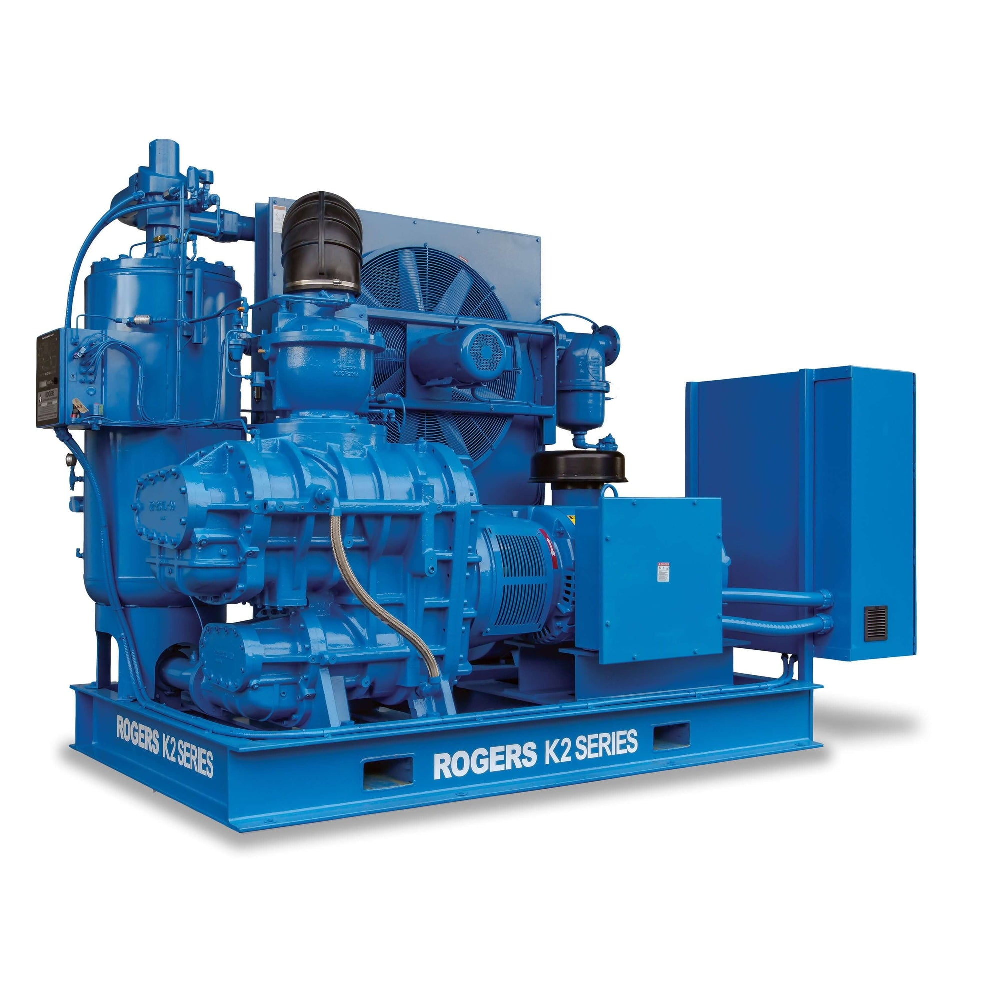

## <i class="bi bi-buildings"></i> Projekt: Etap 2 – Sprężarkownia

Do napełniania naszego zbiornika ($V = 5 \text{ m}^3$) wybrano sprężarkę tłokową. Musimy zweryfikować jej parametry energetyczne i dobrać system chłodzenia.

::: {.columns}
::: {.column width="60%"}
::: {.callout-note title="Założenia projektowe"}
1.  **Powietrze ssane:** $p_1 = p_{atm} = 750 \text{ mmHg} \approx 1 \text{ bar}$ (barometr – jak w Ćw. 1), $t_1 = 20^\circ\text{C}$ (temperatura hali).
2.  **Powietrze tłoczone:** $p_2 = 9.5 \text{ bar}$ (ciśnienie absolutne).
3.  **Wydajność:** $\dot{V}_n = 100 \text{ m}^3/\text{h}$ (normalnych).
4.  **Proces sprężania:** politropa z wykładnikiem $n = 1.35$.
:::
:::
::: {.column width="40%"}

:::
:::

## <i class="bi bi-gear"></i> Zadanie 2.1: Praca Techniczna Sprężania

Oblicz jednostkową pracę techniczną $l_t$ potrzebną do sprężenia 1 kg powietrza.

**Praca techniczna przemiany politropowej:**
$$ l_t = \frac{n}{n-1} R T_1 \left[ 1-\left(\frac{p_2}{p_1}\right)^{\frac{n-1}{n}} \right] $$

::: {.columns}
::: {.column width="32%"}
::: {.callout-note title="Dane"}
*   $R = 287 \text{ J}/(\text{kg}\cdot\text{K})$
*   $T_1 = 293.15 \text{ K}$
*   $p_2/p_1 = 9.5$
*   $n = 1.35$
:::
:::
::: {.column width="68%"}
::: {.panel .panel-blue .fragment}
$$ l_t = \frac{1.35}{0.35} \cdot 287 \cdot 293.15 \cdot \left[ 1-(9.5)^{\frac{0.35}{1.35}} \right] $$
$$ l_t = 3.857 \cdot 84\,134 \cdot [ 1-1.7926 ] \approx 324\,500 \cdot (-0.7926) $$

[$l_t \approx -257\,200 \text{ J/kg} \approx -257 \text{ kJ/kg}$]{.answer}
:::
:::
:::

::: {.fragment .callout-warning title="Uwaga"}
Ujemna **praca techniczna** oznacza, że sprężarka pobiera pracę z zewnątrz – czyli napędzana jest silnikiem!
:::

## <i class="bi bi-lightning-charge"></i> Zadanie 2.2: Moc Silnika Napędowego

Jakiej mocy silnik napędowy ($N$) trzeba zamówić?

::: {.columns}
::: {.column width="50%"}
::: {.panel .panel-blue .fragment}
**1. Strumień masy** (warunki normalne: $p_n = 101\,325$ Pa, $T_n = 273.15$ K):
$$ \dot{m} = \frac{p_n \cdot \dot{V}_n}{R \cdot T_n} = \frac{101\,325 \cdot (100/3600)}{287 \cdot 273.15} $$
$$ \dot{m} = \frac{2814.6}{78\,394} \approx 0.0359 \text{ kg/s} $$
:::
:::
::: {.column width="50%"}
::: {.panel .panel-blue .fragment}
**2. Moc teoretyczna** (z wartości bezwzględnej $l_t$):
$$ N_t = \dot{m} \cdot |l_t| = 0.0359 \cdot 257 \approx 9.23 \text{ kW} $$
:::

::: {.panel .panel-blue .fragment}
**3. Moc silnika** – wyższa ze względu na sprawność mechaniczną $\eta_m = 0.9$:
$$ N = \frac{\dot{m} \cdot |l_t|}{\eta_m} = \frac{9.23}{0.9} $$
:::
:::
:::

::: {.fragment .callout-tip title="Odpowiedź"}
Potrzebny silnik o mocy [$N \approx 10.3 \text{ kW}$]{.answer}.
:::

## <i class="bi bi-fire"></i> Zadanie 2.3: Temperatura Tłoczenia

Do jakiej temperatury nagrzeje się powietrze na wylocie? To kluczowe dla doboru oleju i chłodnicy!

$$ T_2 = T_1 \cdot \left(\frac{p_2}{p_1}\right)^{\frac{n-1}{n}} $$

::: {.panel .panel-blue .fragment}
$$ T_2 = 293.15 \cdot (9.5)^{0.2593} = 293.15 \cdot 1.7926 $$

[$T_2 \approx 525.5 \text{ K} = 252.4^\circ\text{C}$]{.answer}
:::

::: {.fragment .callout-caution title="Zagrożenie"}
$252^\circ\text{C}$ to bardzo wysoka temperatura (oleje sprężarkowe: typowo maks. ok. $180^\circ\text{C}$)! Grozi zapłonem par oleju. Konieczne jest **chłodzenie międzystopniowe** lub intensywne chłodzenie cylindra.
:::

## <i class="bi bi-snow"></i> Zadanie 2.4: Bilans Ciepła (I Zasada)

Ile ciepła musimy odprowadzić w chłodnicy, aby schłodzić powietrze z powrotem do $30^\circ\text{C}$ przed podaniem na halę?

**I Zasada dla układu otwartego** (chłodnica – ciśnienie stałe, $p = \text{const}$):
$$ \dot{Q}_{chl} = \dot{m} \cdot (h_{wylot} - h_{wlot}) = \dot{m} \cdot c_p \cdot (T_{wylot} - T_{wlot}) $$

::: {.columns}
::: {.column width="42%"}
::: {.callout-note title="Dane"}
*   $\dot{m} = 0.0359 \text{ kg/s}$
*   $t_{wlot} = 252.4^\circ\text{C}$ (ze sprężarki)
*   $t_{wylot} = 30^\circ\text{C}$ (wymagane)
*   $c_p \approx 1005 \text{ J}/(\text{kg}\cdot\text{K})$
:::
:::
::: {.column width="58%"}
::: {.panel .panel-blue .fragment}
Różnica temperatur w K = różnica w °C:
$$ \dot{Q}_{chl} = 0.0359 \cdot 1005 \cdot (30 - 252.4) $$

[$\dot{Q}_{chl} \approx -8020 \text{ W} \approx -8.0 \text{ kW}$]{.answer}

Minus oznacza ciepło odprowadzone **z** układu.
:::
:::
:::

## <i class="bi bi-arrow-repeat"></i> Zadanie 2.5: Sprężanie Dwustopniowe

$252^\circ\text{C}$ to za dużo! Rozważmy **sprężanie dwustopniowe** z chłodzeniem międzystopniowym do $30^\circ\text{C}$.

::: {.columns}
::: {.column width="40%"}
::: {.panel .panel-blue}
**Optymalne ciśnienie pośrednie** (minimalna suma prac obu stopni; ściśle – przy chłodzeniu do $T_1$):
$$ p_{pośr} = \sqrt{p_1 \cdot p_2} = \sqrt{1 \cdot 9.5} $$

[$p_{pośr} \approx 3.08 \text{ bar}$]{.answer}
:::
:::
::: {.column width="60%"}
::: {.panel .panel-blue .fragment}
**Temperatura po I stopniu** ($1 \rightarrow 3.08$ bar, $n = 1.35$):
$$ T_{I} = 293.15 \cdot (3.08)^{0.2593} \approx 293.15 \cdot 1.339 $$

[$T_{I} \approx 392.5 \text{ K} \;\Rightarrow\; t_{I,out} \approx 119^\circ\text{C}$]{.answer}
:::

::: {.panel .panel-blue .fragment}
**Temperatura po II stopniu** ($3.08 \rightarrow 9.5$ bar, start od $30^\circ\text{C} = 303.15 \text{ K}$):
$$ T_{II} = 303.15 \cdot (9.5/3.08)^{0.2593} \approx 303.15 \cdot 1.339 $$

[$T_{II} \approx 405.9 \text{ K} \;\Rightarrow\; t_{II,out} \approx 133^\circ\text{C}$]{.answer}
:::
:::
:::

::: {.fragment .callout-tip title="Wniosek"}
$133^\circ\text{C}$ zamiast $252^\circ\text{C}$! Temperatura tłoczenia niższa o ok. **120 K** – bezpieczna dla oleju i uszczelek.
:::

## <i class="bi bi-bar-chart"></i> Zadanie 2.6: Porównanie Procesów Sprężania

Porównaj **co do wartości bezwzględnej** pracę techniczną $|l_t|$ (przy sprężaniu zawsze $l_t < 0$) dla trzech procesów ($p_1 = 1$ bar, $p_2 = 9.5$ bar, $T_1 = 293.15$ K):

::: {.columns}
::: {.column width="34%"}
::: {.panel .panel-green}
**Izotermiczny** ($n = 1$)
$$ |l_t| = R T_1 \ln\frac{p_2}{p_1} $$
$$ |l_t| = 287 \cdot 293.15 \cdot \ln(9.5) $$

[$|l_t| \approx 189 \text{ kJ/kg}$]{.answer}

Minimum teoretyczne.
:::
:::
::: {.column width="30%"}
::: {.panel .panel-blue}
**Politropowy** ($n = 1.35$)

Z Zadania 2.1:

[$|l_t| \approx 257 \text{ kJ/kg}$]{.answer}

Nasza sprężarka (chłodzona).
:::
:::
::: {.column width="36%"}
::: {.panel .panel-amber}
**Adiabatyczny** ($n = \kappa = 1.4$)
$$ |l_t| = \frac{1.4}{0.4} \cdot 287 \cdot 293.15 \cdot $$
$$ \cdot \left[(9.5)^{0.286}-1\right] $$

[$|l_t| \approx 266 \text{ kJ/kg}$]{.answer}

Bez chłodzenia.
:::
:::
:::

::: {.fragment .callout-tip title="Wniosek"}
Sprężanie izotermiczne wymaga o **29% mniej** pracy niż adiabatyczne ($1 - 189/266$) i o ok. **26% mniej** niż nasza politropa ($1 - 189/257$). Dlatego chłodzimy sprężarki!
:::

## <i class="bi bi-lightbulb"></i> Dlaczego $n = 1$ „psuje” wzór?

**Problem:** jeśli wstawisz $n = 1$ do wzoru politropowego, otrzymasz dzielenie przez zero ($\frac{n}{n-1}$). Dlaczego? Bo zmienia się postać funkcji podcałkowej:

$$ l_t = -\int_{p_1}^{p_2} v \, dp $$

::: {.columns}
::: {.column width="50%"}
::: {.panel .panel-blue}
**Dla $n \neq 1$ (politropa):** funkcja potęgowa $v = C \cdot p^{-1/n}$.

Całka z $x^a$ to $\frac{x^{a+1}}{a+1}$ – stąd bierze się ułamek $\frac{n}{n-1}$.
:::
:::
::: {.column width="50%"}
::: {.panel .panel-amber}
**Dla $n = 1$ (izoterma):** funkcja hiperboliczna $v = C/p$.

Całka z $1/x$ to **logarytm naturalny** ($\ln x$)!
$$ l_t = R T_1 \ln\frac{p_1}{p_2} = -R T_1 \ln\frac{p_2}{p_1} $$
:::
:::
:::

::: {.callout-note title="Reguła de l'Hospitala"}
Fizyka się nie „psuje”. Granica wzoru ogólnego przy $n \to 1$ dąży właśnie do wzoru z logarytmem.
:::

## <i class="bi bi-droplet"></i> Zadanie 2.7: Dobór Chłodnicy Wodnej

Musimy odprowadzić $|\dot{Q}_{chl}| \approx 8$ kW z chłodnicy sprężarki (Zad. 2.4). **Oblicz wymagany strumień wody chłodzącej.**

::: {.columns}
::: {.column width="42%"}
::: {.callout-note title="Dane"}
*   Woda z sieci wodociągowej: $t_{w,in} = 15^\circ\text{C}$
*   Maks. temperatura wody na wylocie (założenie projektowe): $t_{w,out} = 40^\circ\text{C}$
*   Ciepło właściwe wody: $c_w = 4190 \text{ J}/(\text{kg}\cdot\text{K})$
:::
:::
::: {.column width="58%"}
::: {.panel .panel-blue .fragment}
$$ |\dot{Q}_{chl}| = \dot{m}_w \cdot c_w \cdot (t_{w,out} - t_{w,in}) $$
$$ \dot{m}_w = \frac{8000}{4190 \cdot (40 - 15)} = \frac{8000}{104\,750} $$

[$\dot{m}_w \approx 0.076 \text{ kg/s} \approx 4.6 \text{ l/min}$]{.answer} [(1 kg wody $\approx$ 1 l)]{.small-note}
:::
:::
:::

::: {.fragment .callout-note title="Koszt wody"}
Przy cenie $8 \text{ zł/m}^3$ i pracy sprężarki 2000 h/rok: $0.076 \cdot 3.6 \cdot 2000 \cdot 8 \approx \mathbf{4380 \text{ zł/rok}}$. Warto rozważyć obieg zamknięty z wieżą chłodniczą!
:::

## <i class="bi bi-search"></i> Zadanie 2.8: Wyznaczanie Wykładnika Politropy

Serwisant zmierzył parametry pracy sprężarki. **Jaki jest rzeczywisty wykładnik politropy $n$ tej sprężarki?**

::: {.columns}
::: {.column width="40%"}
::: {.callout-note title="Pomiary"}
*   Ssanie: $t_1 = 22^\circ\text{C}$, $p_1 = 1$ bar
*   Tłoczenie: $t_2 = 215^\circ\text{C}$, $p_2 = 8$ bar
:::

$$ \frac{T_2}{T_1} = \left(\frac{p_2}{p_1}\right)^{\frac{n-1}{n}} $$
:::
::: {.column width="30%"}
::: {.panel .panel-blue .fragment}
**Krok 1: logarytmowanie**
$$ \frac{488.15}{295.15} = 8^{\frac{n-1}{n}} $$
$$ 1.654 = 8^{\frac{n-1}{n}} $$
$$ \ln(1.654) = \frac{n-1}{n} \cdot \ln(8) $$
:::
:::
::: {.column width="30%"}
::: {.panel .panel-blue .fragment}
**Krok 2: wyznaczenie $n$**
$$ 0.503 = \frac{n-1}{n} \cdot 2.079 $$
$$ \frac{n-1}{n} = 0.242 $$

[$n = \dfrac{1}{1 - 0.242} \approx 1.32$]{.answer}
:::
:::
:::

::: {.fragment .callout-tip title="Wniosek"}
$n = 1.32 < \kappa = 1.4$ – sprężarka jest chłodzona, choć proces wciąż jest bliższy adiabacie niż izotermie.
:::

## <i class="bi bi-house-door"></i> Zadanie Domowe (Raport 2)

**Temat:** odzysk ciepła.

Skoro wyrzucamy 8 kW ciepła do otoczenia, inżynier produkcji proponuje wykorzystać je do podgrzewania wody użytkowej w umywalniach.

::: {.callout-note title="Dane"}
1.  Woda wodociągowa ma temperaturę $10^\circ\text{C}$.
2.  Chcemy ją podgrzać do $45^\circ\text{C}$.
3.  Zakładamy, że odzyskamy 80% ciepła z chłodnicy sprężarki ($0.8 \cdot 8 \text{ kW}$).
4.  Ciepło właściwe wody: $c_w = 4190 \text{ J}/(\text{kg}\cdot\text{K})$.
:::

::: {.panel .panel-amber}
**Zadanie:** oblicz, jaki strumień wody $\dot{m}_w$ [l/min] możemy podgrzać.
:::
