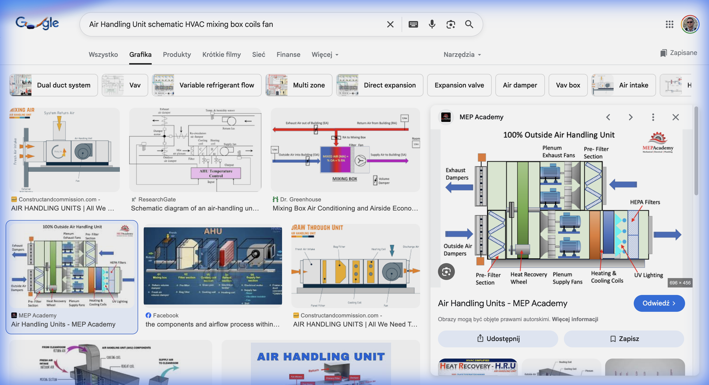
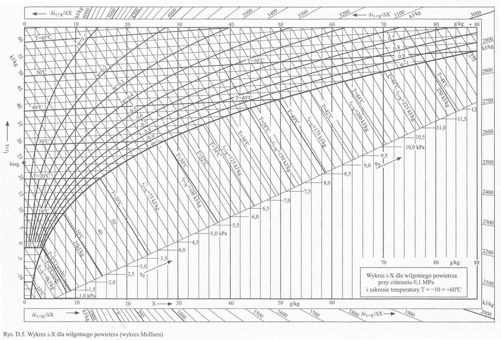

## <i class="bi bi-buildings"></i> Projekt: Etap Finalny – HVAC

W hali montażu elektroniki musimy utrzymać ściśle określone warunki, aby uniknąć wyładowań elektrostatycznych (ESD) i korozji. HVAC (ang. *heating, ventilation, air conditioning*) – ogrzewanie, wentylacja, klimatyzacja.

::: {.columns}
::: {.column width="55%"}
::: {.callout-note title="Wymagania hali (punkt W)"}
1.  **Temperatura:** $t_W = 22\ \text{°C} \pm 1\,\text{K}$
2.  **Wilgotność:** $\varphi_W = 50\% \pm 5\%$
3.  **Zyski ciepła jawnego:** $Q_j = 50\ \text{kW}$
4.  **Zyski wilgoci:** $\dot{W} = 10\ \text{kg/h}$
:::

::: {.panel .panel-amber}
[Zadanie]{.panel-title}
Zaprojektować proces przygotowania powietrza w centrali wentylacyjnej (zima/lato).
:::
:::
::: {.column width="45%"}
{width="100%"}
:::
:::

## <i class="bi bi-clipboard-data"></i> Założenia i Oznaczenia (jak w Karcie Projektowej) {.small}

::: {.callout-note title="Dane wspólne"}
*   **Centrala:** $\dot{V} = 25\,000\ \text{m}^3/\text{h}$, $\rho \approx 1.2\ \text{kg/m}^3$ → $\dot{m} \approx 8.33\ \text{kg/s}$; $c_p = 1.005\ \text{kJ/(kg}\cdot\text{K)}$.
*   **Nawiew latem:** $t_N = t_W - 4\,\text{K}$.
:::

::: {.panel .panel-blue}
[Oznaczenia]{.panel-title}

*   **Punkty na wykresie h-X:** **Z** – powietrze zewnętrzne, **P** – za nagrzewnicą (zima), **N** – nawiew, **W** – hala, **R** – za chłodnicą (punkt rosy), **M** – mieszanina (recyrkulacja).
*   **Jednostki:** zawilżenie $X$ w g/kg, entalpia $h$ w kJ/kg – obie odniesione do **1 kg powietrza suchego**.
*   Na wykresie entalpia jest oznaczona $i_{1+X}$ – to to samo co $h$.
:::

::: {.callout-warning title="Ciśnienie"}
Wykres h-X sporządzono dla 0.1 MPa, a wartości w przykładach (i w karcie) liczono dla $p = 101.325$ kPa – odczytane z wykresu $X$ wyjdzie ok. 1% większe (np. $X_W \approx 8.4$ zamiast $8.3\ \text{g/kg}$); oba wyniki są poprawne.
:::

## <i class="bi bi-snow"></i> Zadanie 7.1: Proces Zimowy (Ogrzewanie + Nawilżanie) {.small}

Zimą powietrze zewnętrzne ma parametry: $t_Z = -10\ \text{°C}$, $\varphi_Z = 90\%$. Musimy je doprowadzić do stanu nawiewu $N$ (upraszczamy: $t_N = t_W$, $X_N = X_W$).

::: {.columns}
::: {.column width="50%"}
::: {.callout-note title="Krok 1: Odczyt z wykresu h-X"}
1.  Punkt Z ($t_Z = -10\ \text{°C}$, $\varphi_Z = 90\%$): $X_Z \approx 1.4\ \text{g/kg}$, $h_Z \approx -6.5\ \text{kJ/kg}$.
2.  Punkt W ($t_W = 22\ \text{°C}$, $\varphi_W = 50\%$): $X_W \approx 8.3\ \text{g/kg}$ (z wykresu dla 0.1 MPa: $\approx 8.4\ \text{g/kg}$).
:::

::: {.fragment}
Aby osiągnąć $X_W$ z $X_Z$, musimy **dodać wilgoć** (nawilżanie parowe – izoterma). Aby osiągnąć $t_W$, musimy **ogrzać** powietrze.
:::
:::
::: {.column width="50%"}
::: {.panel .panel-blue .fragment}
[Krok 2: Sekwencja procesów w centrali]{.panel-title}

1.  **Nagrzewnica wstępna:** ogrzewanie $Z \rightarrow P$ ($X = \text{const}$).
2.  **Nawilżacz parowy:** nawilżanie $P \rightarrow N$ ($t \approx \text{const}$).
3.  Stan nawiewu $N$ musi mieć $X_N = X_W$ (przyjmujemy bilans wilgoci $\approx 0$).
:::

::: {.panel .panel-blue .fragment}
[Obliczenia]{.panel-title}

*   $X_P = X_Z \approx 1.4\ \text{g/kg}$, $t_P = t_W = 22\ \text{°C}$ → [$h_P \approx 26\ \text{kJ/kg}$]{.answer}
*   [$X_N = X_W \approx 8.3\ \text{g/kg}$]{.answer}
*   $t_N \approx t_W = 22\ \text{°C}$ (uproszczenie: pomijamy straty ciepła hali).
:::
:::
:::

## <i class="bi bi-graph-up"></i> Wizualizacja na Wykresie h-X (zima) {.small}

:::: {.columns}

::: {.column width="70%"}
::: {style="position: relative; display: block; width: 100%; margin: 0 auto;"}
{width="100%"}

<!-- Overlay coords: left = 0.95*x_img (img max-width 95%), top = 1.6 + 0.958*y_img (p margin) -->
<!-- Step 1: Point Z (-10 °C, X = 1.46 g/kg on the 0.1 MPa chart) -->
::: {.fragment fragment-index=1 style="position: absolute; top: 81%; left: 6.03%; width: 0; height: 0;"}

  Punkt Z

:::

<!-- Step 2: Point W (22 °C, X = 8.37 g/kg on the 0.1 MPa chart) -->
::: {.fragment fragment-index=2 style="position: absolute; top: 49.9%; left: 12.78%; width: 0; height: 0;"}

  Punkt W

:::

<!-- Step 3: Heating Z -> P (X = const), P on the 22 °C isotherm -->
::: {.fragment fragment-index=3}

P (tP)

:::

<!-- Step 4: Humidifying P -> N = W (t = const) -->
::: {.fragment fragment-index=4}
<svg style="position: absolute; top: 0; left: 0; width: 100%; height: 100%; pointer-events: none; z-index: 1;">
  <line x1="6.03%" y1="50.2%" x2="12.78%" y2="49.9%" style="stroke:blue;stroke-width:2" />
</svg>
<svg style="position: absolute; top: 0; left: 0; width: 100%; height: 100%; pointer-events: none; z-index: 1;">
  <line x1="9.4%" y1="49.6%" x2="12.9%" y2="37%" style="stroke:blue;stroke-width:2" />
</svg>

  izotermiczne nawilżanie
  

:::

:::
:::

::: {.column width="30%"}
Jak narysować proces zimowy?

::: {.fragment fragment-index=1}
**1. Punkt Z** – $-10\ \text{°C}$, $90\%$. Odczytaj $X_Z$.
:::

::: {.fragment fragment-index=2}
**2. Punkt W** – $22\ \text{°C}$, $50\%$. Odczytaj $X_W$.
:::

::: {.fragment fragment-index=3}
**3. Nagrzewanie** – pionowo w górę od Z ($X = \text{const}$) do temperatury $t_P = t_W$ (punkt P).
:::

::: {.fragment fragment-index=4}
**4. Nawilżanie** – po izotermie ($t \approx \text{const}$) w prawo, aż osiągniesz $X_W$.
:::

::: {.fragment fragment-index=5}
**5. Entalpia** – od punktu idź równolegle do ukośnych linii $i_{1+X} = \text{const}$ do lewej skali [kJ/kg] ($i_{1+X} \equiv h$): [$h_Z \approx -6.5$, $h_P \approx 26\ \text{kJ/kg}$]{.answer}.
:::
:::

::::

## <i class="bi bi-sun"></i> Zadanie 7.2: Proces Letni (Chłodzenie + Osuszanie) {.small}

::: {.columns}
::: {.column width="45%"}
::: {.callout-note title="Dane"}
Latem jest gorąco i wilgotno: $t_Z = 32\ \text{°C}$, $\varphi_Z = 45\%$.

*   Punkt Z: $X_Z \approx 13.5\ \text{g/kg}$, $h_Z \approx 67\ \text{kJ/kg}$.
*   Punkt W: $X_W \approx 8.3\ \text{g/kg}$.
:::

::: {.panel .panel-amber .fragment}
[Analiza]{.panel-title}
$X_Z > X_W$ ($13.5 > 8.3$) $\Rightarrow$ [musimy **osuszać**!]{.answer}
:::
:::
::: {.column width="55%"}
::: {.panel .panel-blue .fragment}
[Proces w chłodnicy]{.panel-title}
Chłodzenie przebiega przy $X = \text{const}$ do punktu rosy, a potem po linii nasycenia ($\varphi = 100\%$). Wykraplanie wody zachodzi na powierzchni chłodnicy.

1.  Oziębiamy powietrze aż do $X = X_W \approx 8.3\ \text{g/kg}$ (na linii nasycenia) – punkt R. To wymaga temperatury punktu rosy (tzw. punktu rosy aparatu): [$t_R \approx 11.1\ \text{°C}$]{.answer}, $h_R \approx 32\ \text{kJ/kg}$.
2.  Ale $11.1\ \text{°C}$ to za zimno dla ludzi!
3.  Musimy podgrzać powietrze (nagrzewnica wtórna, $X = \text{const}$) do $t_N = t_W - 4\,\text{K} = 18\ \text{°C}$: [$h_N \approx 39\ \text{kJ/kg}$]{.answer}.
:::
:::
:::

::: {.fragment .callout-tip title="Wniosek"}
Latem musimy najpierw mocno chłodzić (by osuszyć), a potem lekko podgrzać! To duży koszt energetyczny.
:::

## <i class="bi bi-graph-up"></i> Wizualizacja na Wykresie h-X (lato) {.small}

:::: {.columns}

::: {.column width="70%"}
::: {style="position: relative; display: block; width: 100%; margin: 0 auto;"}
{width="100%"}

<!-- Step 1: Point Z (32 °C, X = 13.67 g/kg on the 0.1 MPa chart) -->
::: {.fragment fragment-index=1 style="position: absolute; top: 39.9%; left: 17.95%; width: 0; height: 0;"}

<!-- Label to the RIGHT of Z to avoid cooling line -->

  Punkt Z

:::

<!-- Step 2: Cooling & Dehumidification (Z -> saturation at X_Z -> R along phi = 100%) -->
::: {.fragment fragment-index=2}
<!-- Point R (dew point of W): 11.1 °C, X = 8.37 g/kg -->

R

<!-- Cooling: X = const down to saturation (18.6 °C), then along the saturation curve to R -->
<svg viewBox="0 0 100 100" preserveAspectRatio="none" style="position: absolute; top: 0; left: 0; width: 100%; height: 100%; pointer-events: none; z-index: 1;">
  <polyline points="17.95,39.88 17.95,53.08 16.65,54.68 15.18,56.69 13.88,58.67 12.78,60.54" style="fill:none;stroke:blue;stroke-width:2" vector-effect="non-scaling-stroke" />
</svg>
<!-- Label to the RIGHT of Cooling Process -->

  Chłodzenie + Osuszanie

:::

<!-- Step 3: Heating (R -> N), N: 18 °C, X = 8.37 g/kg -->
::: {.fragment fragment-index=3}

N

<!-- Heating Line -->

<!-- Label to the LEFT of Heating Process -->

  Nagrzewanie

:::

<!-- Final State: W (Reference), 22 °C, X = 8.37 g/kg -->

:::
:::

::: {.column width="30%"}
Jak narysować proces letni?

::: {.fragment fragment-index=1}
**1. Punkt Z** – $32\ \text{°C}$, $45\%$. Wilgotno i gorąco.
:::

::: {.fragment fragment-index=2}
**2. Chłodzenie i osuszanie** – oziębiamy powietrze do punktu rosy, a dalej wzdłuż krzywej $\varphi = 100\%$, aż $X = X_W \approx 8.3\ \text{g/kg}$ (punkt R). [$t_R \approx 11.1\ \text{°C}$]{.answer}.
:::

::: {.fragment fragment-index=3}
**3. Nagrzewanie wtórne** – $11.1\ \text{°C}$ to za zimno! Podgrzewamy powietrze ($X = \text{const}$) do temperatury nawiewu $t_N = t_W - 4\,\text{K} = 18\ \text{°C}$ (punkt N).
:::
:::

::::

## <i class="bi bi-building-gear"></i> Zadanie 7.3: Bilans Centrali {.small}

Oblicz moc chłodniczą i grzewczą dla strumienia $\dot{V} = 25\,000\ \text{m}^3/\text{h}$, $\rho \approx 1.2\ \text{kg/m}^3$:
$\dot{m} = \rho \cdot \dfrac{\dot{V}}{3600} = 1.2 \cdot \dfrac{25\,000}{3600} \approx 8.33\ \text{kg/s}$.

::: {.columns}
::: {.column width="50%"}
::: {.panel .panel-blue .fragment}
[Chłodnica (lato)]{.panel-title}
$h_Z (32\ \text{°C}, 45\%) \approx 67\ \text{kJ/kg}$, $h_R (11.1\ \text{°C}, 100\%) \approx 32\ \text{kJ/kg}$.
$$ \dot{Q}_{ch} = \dot{m} (h_Z - h_R) = 8.33 \cdot (67 - 32) = 8.33 \cdot 35 $$

[$\dot{Q}_{ch} \approx 292\ \text{kW}$]{.answer}
:::
:::
::: {.column width="50%"}
::: {.panel .panel-blue .fragment}
[Nagrzewnica wtórna (lato)]{.panel-title}
$h_R (11.1\ \text{°C}) \approx 32\ \text{kJ/kg}$, $h_N (18\ \text{°C}, X = 8.3\ \text{g/kg}) \approx 39\ \text{kJ/kg}$.
$$ \dot{Q}_{grz} = \dot{m} (h_N - h_R) = 8.33 \cdot (39 - 32) = 8.33 \cdot 7 $$

[$\dot{Q}_{grz} \approx 58\ \text{kW}$]{.answer}
:::
:::
:::

::: {.fragment .callout-important title="Wniosek"}
Marnujemy ok. 58 kW ciepła, żeby podgrzać powietrze, które wcześniej schłodziliśmy!
**Rozwiązanie:** rekuperacja chłodu lub by-pass powietrza.
:::

## <i class="bi bi-search"></i> Zadanie 7.4: Punkt Rosy – Kontrola Kondensacji {.small}

W hali temperatura wewnętrznej powierzchni ściany zewnętrznej spada zimą do $12\ \text{°C}$. Czy przy parametrach wewnętrznych ($22\ \text{°C}$, $50\%$) dojdzie do **kondensacji na ścianie**?

::: {.columns}
::: {.column width="45%"}
::: {.callout-note title="Wyznacz punkt rosy z wykresu h-X"}
1.  Punkt W: $t_W = 22\ \text{°C}$, $\varphi_W = 50\% \rightarrow X_W \approx 8.3\ \text{g/kg}$.
2.  Punkt rosy: idź w dół po $X = \text{const}$ aż do przecięcia z krzywą $\varphi = 100\%$.
:::
:::
::: {.column width="55%"}
::: {.panel .panel-blue .fragment}
[Punkt rosy]{.panel-title}
$$ t_R (X_W = 8.3\ \text{g/kg}) \approx 11.1\ \text{°C} $$

Ściana ma $12\ \text{°C} > t_R = 11.1\ \text{°C}$ → [kondensacji **nie ma**]{.answer}, ale zapas to tylko $0.9\,\text{K}$ – **na granicy!** Przy niewielkim spadku temperatury ściany pojawi się rosa.

[Gdy $|t_{\text{ściany}} - t_R| < 0.5\,\text{K}$, wynik uznajemy za „na granicy” (dokładność odczytu z wykresu).]{.small-note}
:::
:::
:::

::: {.fragment .callout-caution title="Decyzja"}
Należy docieplić ścianę (zmniejszyć współczynnik przenikania ciepła $U$ – wzrośnie temperatura jej wewnętrznej powierzchni) lub obniżyć wilgotność w hali do $\varphi \le 45\%$ ($t_R \approx 9.5\ \text{°C}$).
:::

## <i class="bi bi-search"></i> Zadanie 7.4: Punkt Rosy – Wykres

{width="58%" fig-align="center"}

## <i class="bi bi-rulers"></i> Zadanie 7.5: Wymagany Strumień Powietrza {.small}

Oblicz minimalny strumień powietrza nawiewanego, aby pokryć zyski ciepła jawnego ($Q_j = 50$ kW) i wilgoci ($\dot{W} = 10$ kg/h).

::: {.columns}
::: {.column width="40%"}
::: {.callout-note title="Dane"}
*   $t_N = t_W - 4\,\text{K} = 18\ \text{°C}$ (jak w Zad. 7.2)
*   $t_W = 22\ \text{°C}$
*   $c_p = 1.005\ \text{kJ/(kg}\cdot\text{K)}$
*   $\rho \approx 1.2\ \text{kg/m}^3$
:::
:::
::: {.column width="60%"}
::: {.panel .panel-blue .fragment}
[Bilans ciepła jawnego]{.panel-title}
$$ Q_j = \dot{m} \cdot c_p \cdot (t_W - t_N) $$
$$ \dot{m} = \frac{Q_j}{c_p \, (t_W - t_N)} = \frac{50}{1.005 \cdot (22 - 18)} = \frac{50}{4.02} \approx 12.44\ \text{kg/s} $$

[$\dot{V} = \dfrac{12.44}{1.2} \approx 10.4\ \text{m}^3/\text{s} \approx 37\,300\ \text{m}^3/\text{h}$]{.answer}
:::
:::
:::

::: {.panel .panel-green .fragment}
[Weryfikacja bilansu wilgoci]{.panel-title}
$$ \Delta X = \frac{\dot{W}}{\dot{m}} = \frac{10/3600}{12.44} = 0.000223\ \text{kg/kg} = 0.22\ \text{g/kg} $$
$X_N = X_W - \Delta X = 8.3 - 0.22 \approx 8.1$ g/kg → praktycznie brak zmiany. Zyski wilgoci są niewielkie.
:::

## <i class="bi bi-arrow-repeat"></i> Zadanie 7.6: Recyrkulacja Powietrza

Zamiast pobierać 100% powietrza zewnętrznego, stosujemy **recyrkulację**: $r = 70\%$ powietrza wraca z hali (stan W), $100\% - r = 30\%$ to świeże powietrze (stan Z).

::: {.callout-note title="Dane (lato)"}
Punkt Z (zewn.): $32\ \text{°C}$, $45\%$, $X_Z \approx 13.5$ g/kg. Punkt W (hala): $22\ \text{°C}$, $50\%$, $X_W \approx 8.3$ g/kg.
:::

::: {.panel .panel-blue .fragment}
[Punkt mieszaniny M]{.panel-title}
$$ t_M = \tfrac{r}{100}\, t_W + \left(1 - \tfrac{r}{100}\right) t_Z = 0.7 \cdot 22 + 0.3 \cdot 32 = 15.4 + 9.6 $$
$$ X_M = \tfrac{r}{100}\, X_W + \left(1 - \tfrac{r}{100}\right) X_Z = 0.7 \cdot 8.3 + 0.3 \cdot 13.5 = 5.81 + 4.05 $$

[$t_M = 25.0\ \text{°C}$, $X_M = 9.86\ \text{g/kg}$]{.answer}
:::

## <i class="bi bi-arrow-repeat"></i> Zadanie 7.6 (cd.): Analiza Oszczędności

::: {.panel .panel-blue}
[Porównanie obciążenia osuszania]{.panel-title}

*   Bez recyrkulacji ($X_Z = 13.5$): musimy usunąć $13.5 - 8.3 = 5.2$ g/kg.
*   Z recyrkulacją ($X_M = 9.86$): musimy usunąć $9.86 - 8.3 = 1.56$ g/kg.
:::

::: {.fragment .callout-tip title="Wniosek"}
Redukcja obciążenia osuszania o [**70%**]{.answer} ($1 - 1.56/5.2 = 0.70$)! → Mniejsza chłodnica, mniejszy koszt energii.
Uwaga: redukcja zawsze równa się udziałowi recyrkulacji $r$, bo $X_M - X_W = \left(1 - \tfrac{r}{100}\right)(X_Z - X_W)$.
:::

::: {.fragment .callout-note title="Uwaga"}
Recyrkulacja to **najskuteczniejszy** sposób zmniejszenia kosztów energetycznych centrali. Ograniczenie: wymogi higieniczne — w pomieszczeniach klimatyzowanych min. 30 m³/h powietrza zewnętrznego na osobę (PN-B-03430/Az3:2000, przywołana w Warunkach Technicznych; ogólnie 20 m³/h).
:::

## <i class="bi bi-droplet"></i> Zadanie 7.7: Ilość Kondensatu (Lato) {.small}

W procesie letnim (chłodzenie + osuszanie) z powietrza wykrapla się woda. Ile litrów na godzinę?

::: {.columns}
::: {.column width="45%"}
::: {.callout-note title="Dane"}
*   Strumień masy powietrza: $\dot{m} = 8.33$ kg/s (z Zad. 7.3)
*   $X_Z \approx 13.5$ g/kg, za chłodnicą $X_R = X_W \approx 8.3$ g/kg
*   $\rho_w \approx 1\ \text{kg/l}$
:::
:::
::: {.column width="55%"}
::: {.panel .panel-blue .fragment}
[Zmiana zawilżenia i strumień kondensatu]{.panel-title}
$$ \Delta X = X_Z - X_R = 13.5 - 8.3 = 5.2\ \text{g/kg} = 0.0052\ \text{kg/kg} $$
$$ \dot{m}_w = \dot{m} \cdot \Delta X = 8.33 \cdot 0.0052 = 0.0433\ \text{kg/s} $$

[$\dot{V}_w = 0.0433 \cdot 3600 \approx 156\ \text{l/h}$]{.answer}
:::
:::
:::

::: {.fragment .callout-note title="Uwaga"}
To ok. **2.6 litra na minutę** wykroplonej wody! Musi być odprowadzona do kanalizacji przez syfon (aby nie wciągać powietrza). Tę wodę (o niskiej mineralizacji) można po uzdatnieniu wykorzystać np. do nawilżania.
:::

## <i class="bi bi-building-gear"></i> Zadanie 7.8: Nagrzewnica Zimowa – Moc {.small}

Oblicz moc nagrzewnicy zimowej dla strumienia $\dot{V} = 25\,000\ \text{m}^3/\text{h}$ powietrza podgrzewanego od $-10\ \text{°C}$ do $22\ \text{°C}$ (proces $Z \rightarrow P$ z Zad. 7.1).

::: {.columns}
::: {.column width="45%"}
::: {.callout-note title="Z wykresu h-X"}
*   $\dot{m} = 1.2 \cdot \dfrac{25\,000}{3600} \approx 8.33\ \text{kg/s}$
*   $h_Z (-10\ \text{°C}, 90\%) \approx -6.5\ \text{kJ/kg}$
*   $h_P (22\ \text{°C}, X = 1.4\ \text{g/kg}) \approx 26\ \text{kJ/kg}$
:::
:::
::: {.column width="55%"}
::: {.panel .panel-blue .fragment}
[Moc nagrzewnicy]{.panel-title}
$$ \dot{Q}_{nagr} = \dot{m} (h_P - h_Z) = 8.33 \cdot (26 - (-6.5)) = 8.33 \cdot 32.5 $$

[$\dot{Q}_{nagr} \approx 271\ \text{kW}$]{.answer}
:::
:::
:::

::: {.fragment .callout-warning title="Uwaga"}
$271\ \text{kW}$ to jak ogrzewanie **ok. 14 domów jednorodzinnych** (przyjmując ok. 20 kW na dom)! Dlatego rekuperacja (odzysk ciepła) jest kluczowa – może zaoszczędzić ok. 75% tej mocy (Zad. 7.9).
:::

## <i class="bi bi-building-gear"></i> Zadanie 7.8: Nagrzewnica Zimowa – Wykres

{width="58%" fig-align="center"}

## <i class="bi bi-arrow-left-right"></i> Zadanie 7.9: Odzysk Ciepła (Rekuperacja) {.small}

Wymiennik krzyżowy (rekuperator) o sprawności temperaturowej $\eta = 75\%$ podgrzewa powietrze świeże ($t_Z = -10\ \text{°C}$) ciepłem powietrza wywiewanego z hali ($t_W = 22\ \text{°C}$). Strumień: $\dot{V} = 25\,000\ \text{m}^3/\text{h}$ → $\dot{m} = 8.33$ kg/s.

::: {.columns}
::: {.column width="50%"}
::: {.panel .panel-blue .fragment}
[1. Temperatura za rekuperatorem (przed nagrzewnicą)]{.panel-title}
$$ \eta = \frac{t_{odz} - t_Z}{t_W - t_Z} \;\Rightarrow\; t_{odz} = t_Z + \eta \, (t_W - t_Z) $$
$$ t_{odz} = -10 + 0.75 \cdot (22 - (-10)) = -10 + 24 $$

[$t_{odz} = 14\ \text{°C}$]{.answer}
:::
:::
::: {.column width="50%"}
::: {.panel .panel-blue .fragment}
[2. Zaoszczędzona moc grzewcza (warunki obliczeniowe)]{.panel-title}
$$ \Delta\dot{Q} = \dot{m} \, c_p \, (t_{odz} - t_Z) = 8.33 \cdot 1.005 \cdot (14 - (-10)) $$

[$\Delta\dot{Q} \approx 201\ \text{kW}$]{.answer}

Nagrzewnica musi dostarczyć już tylko ok. $271 - 201 = 70$ kW (oszczędność ok. 74%).
:::
:::
:::

## <i class="bi bi-arrow-left-right"></i> Zadanie 7.9 (cd.): Czy Rekuperator się Opłaci? {.small}

::: {.callout-note title="Dane"}
Średnia sezonowa temperatura zewnętrzna $t_{Z,\text{śr}} = +2\ \text{°C}$, 3000 h pracy w sezonie, cena ciepła 0.35 zł/kWh. Rekuperator kosztuje ok. 150 000 zł.
:::

::: {.columns}
::: {.column width="50%"}
::: {.panel .panel-blue .fragment}
[Średnia moc odzyskiwana w sezonie]{.panel-title}
(ta sama sprawność, mniejsza różnica temperatur)
$$ \Delta\dot{Q}_{\text{śr}} = \dot{m} \, c_p \, \eta \, (t_W - t_{Z,\text{śr}}) $$
$$ \Delta\dot{Q}_{\text{śr}} = 8.33 \cdot 1.005 \cdot 0.75 \cdot (22 - 2) $$

[$\Delta\dot{Q}_{\text{śr}} \approx 125.6\ \text{kW}$]{.answer}
:::
:::
::: {.column width="50%"}
::: {.panel .panel-blue .fragment}
[Roczna oszczędność i okres zwrotu]{.panel-title}
$$ E = 125.6\ \text{kW} \cdot 3000\ \text{h} \approx 376\,800\ \text{kWh} $$
$$ K = 376\,800 \cdot 0.35 \approx 132\,000\ \text{zł/rok} $$

[$T_{zw} = \dfrac{150\,000}{132\,000} \approx 1.1\ \text{roku}$]{.answer}
:::
:::
:::

::: {.fragment .callout-important title="Uwaga"}
Nie licz oszczędności dla mocy obliczeniowej ($201\ \text{kW} \cdot 3000\ \text{h}$) – temperatura $-10\ \text{°C}$ występuje tylko przez kilka dni w roku; zawyżyłbyś oszczędność o ok. 60%.
:::

## <i class="bi bi-house-door"></i> Zadanie Domowe (Raport 7)

**Temat:** Etap 7 Karty Projektowej – Centrala Klimatyzacyjna.

::: {.panel .panel-amber}
1.  Rozwiąż zadania 7.1–7.9 dla **swoich** danych z karty ($t_Z$ zima/lato, $t_W$, $\dot{V}$, $Q_j$, $r$).
2.  Na jednym wykresie h-X zaznacz wszystkie punkty (Z, P, N, W, R, M) oraz procesy zimowy i letni.
3.  Oceń wyniki: czy strumień centrali wystarcza do pokrycia zysków ciepła (Zad. 7.5)? Czy rekuperator się opłaca (Zad. 7.9)?
:::
