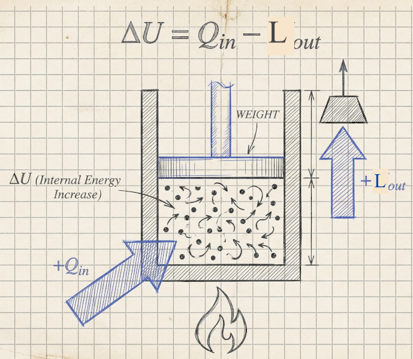
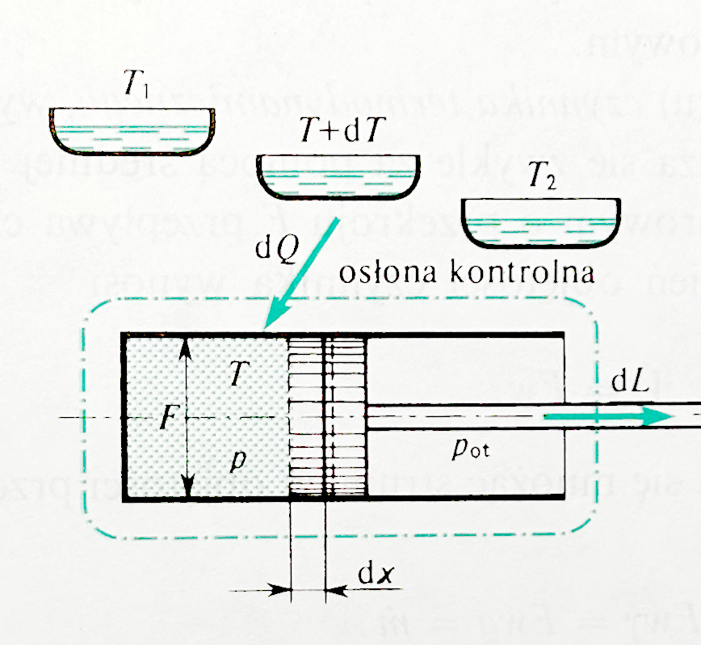
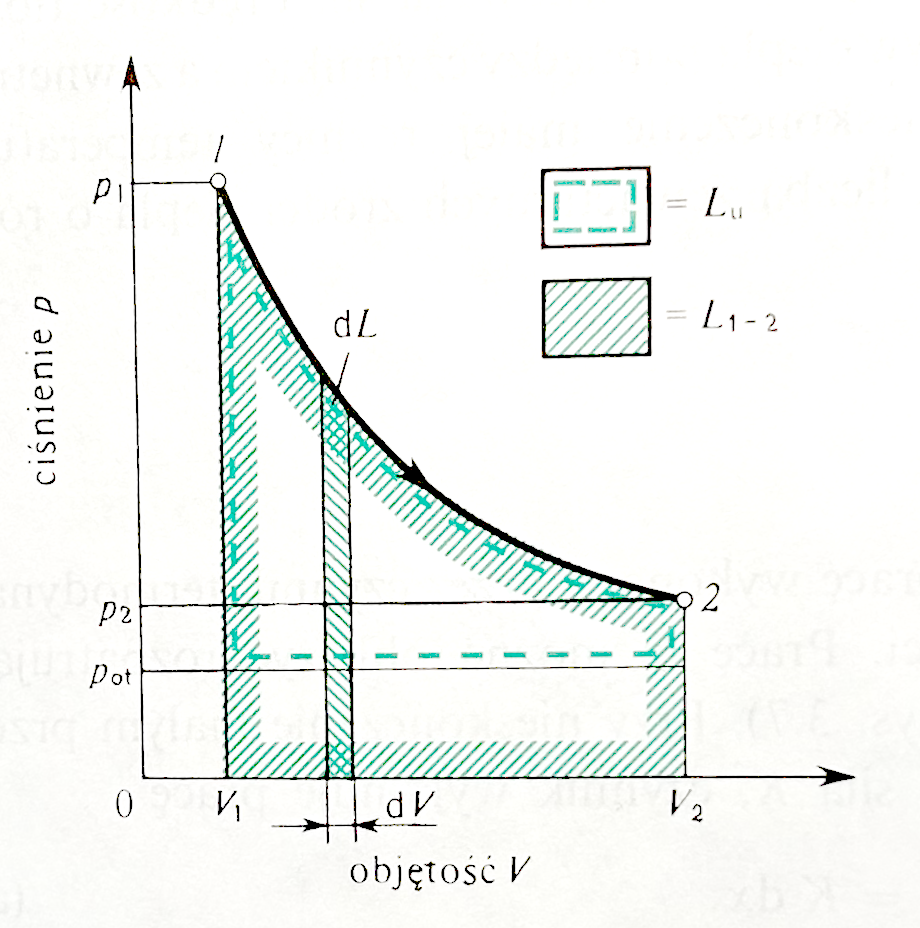

```{r}
#| label: setup
#| include: false

library(ggplot2)
source("../theme/ggtheme.R")   # wspólny styl wykresów i paleta slajdów
theme_set(theme_slides(16))
knitr::opts_chunk$set(dev.args = list(bg = "transparent"))
```

## <i class="bi bi-file-earmark-text"></i> Wstęp do I Zasady Termodynamiki

### Zasada Zachowania Energii

::: {.panel .panel-blue}
**Pierwsza Zasada Termodynamiki** to sformułowanie zasady **zachowania energii** dla zjawisk termicznych.
:::

::::: columns
::: {.column width="60%"}
::: incremental
*   Postuluje ona równoważność **pracy ($L$)** i **ciepła ($Q$)** jako sposobów przekazywania energii.
*   Dla układu izolowanego zmiana energii wewnętrznej wynosi zero: $dU = 0$.
*   Niemożliwe jest zbudowanie **perpetuum mobile pierwszego rodzaju** (maszyny wykonującej pracę bez zasilania energią z zewnątrz).
:::
:::

::: {.column width="40%"}
{width="90%" fig-align="center"}
:::
:::::

## <i class="bi bi-battery-charging"></i> Energia Wewnętrzna ($U$)

### Definicja i Charakterystyka

::: {.panel .panel-blue}
**Energia wewnętrzna ($U$)** to suma energii kinetycznej chaotycznego (mikroskopowego) ruchu składników układu i energii potencjalnej ich wzajemnego oddziaływania. Nie obejmuje makroskopowej energii kinetycznej i potencjalnej układu jako całości.
:::

::: incremental
*   Jest **funkcją stanu**: jej zmiana zależy tylko od stanu początkowego i końcowego, a nie od drogi procesu.
*   Jest wielkością **ekstensywną** (addytywną).
*   Dla **gazu doskonałego** $U$ zależy wyłącznie od temperatury: $U = f(T)$.
:::

## <i class="bi bi-calculator"></i> Różniczki Zupełne i Niezupełne {.smaller}

### d vs. đ

W termodynamice kluczowe jest rozróżnienie matematyczne:

::: incremental
1.  **Różniczka zupełna ($d$):** Dotyczy funkcji stanu ($U, H, S$). Całka po drodze zamkniętej wynosi zero: $\oint dU = 0$.
2.  **Różniczka niezupełna ($đ$):** Dotyczy wielkości procesowych ($Q, L$) – jest to forma Pfaffa, która nie jest różniczką zupełną żadnej funkcji stanu. Ich wartość zależy od drogi przejścia: $\oint đQ \neq 0$.
:::

::: {.fragment .fade-up .callout-warning title="Ciekawe"}
*Czynnik całkujący ($1/T$) pozwala zamienić $đQ$ w różniczkę zupełną entropii $dS = đQ_{\text{odwr}}/T$ (dla procesu odwracalnego)*.
:::

::: {.fragment .fade-up .callout-note title="Do tego wrócimy..."}
W tym momencie wchodzimy w podstawy II zasady termodynamiki...
:::

## <i class="bi bi-fire"></i> Ciepło ($Q$) {.smaller}

::::: columns
::: {.column width="50%"}
### Definicja i Konwencja Znaków

::: {.panel .panel-amber}
**Ciepło** to energia przekazywana przez granicę układu na skutek **różnicy temperatur**.
:::

::: incremental
*   Nie jest funkcją stanu (zależy od drogi procesu).
*   **$đQ > 0$:** układ pobiera ciepło z otoczenia.
*   **$đQ < 0$:** układ oddaje ciepło do otoczenia.
:::

::: {.fragment .fade-up .panel .panel-blue}
**I Zasada Termodynamiki (postać różniczkowa):**
$$ dU = đQ - đL $$
:::
:::

::: {.column width="50%"}
```{r}
#| label: fig-sign-convention
#| fig-cap: "Konwencja znaków dla ciepła (Q) i pracy (L)"
#| echo: false
#| fig-align: center
#| fig-width: 8
#| fig-height: 5
#| out-width: "95%"

col_q <- pal_slides[2]   # ciepło – pomarańcz
col_l <- pal_slides[1]   # praca – niebieski

ggplot() +
  # 1. Układ (ramka centralna)
  geom_rect(aes(xmin = -2, xmax = 2, ymin = -1.5, ymax = 1.5),
            fill = "white", color = col_ink, linewidth = 1.2) +
  annotate("text", x = 0, y = 0, label = "UKŁAD", size = 8, fontface = "bold", color = col_ink) +

  # 2. Osłona bilansowa (ramka przerywana)
  geom_rect(aes(xmin = -3, xmax = 3, ymin = -2.5, ymax = 2.5),
            fill = NA, color = col_ink2, linetype = "dashed", linewidth = 0.8) +

  # 3. Ciepło: Q > 0 (doprowadzone od góry)
  geom_segment(aes(x = 0, xend = 0, y = 3.5, yend = 1.6),
               arrow = arrow(length = unit(0.5, "cm"), type = "closed"),
               color = col_q, linewidth = 1.6) +
  annotate("text", x = 0, y = 3.9, label = "Q > 0", color = col_q, size = 6, fontface = "bold") +

  # Q < 0 (odprowadzone do dołu)
  geom_segment(aes(x = 0, xend = 0, y = -1.6, yend = -3.5),
               arrow = arrow(length = unit(0.5, "cm"), type = "closed"),
               color = col_q, linewidth = 1.6) +
  annotate("text", x = 0, y = -3.9, label = "Q < 0", color = col_q, size = 6, fontface = "bold") +

  # 4. Praca: L < 0 (doprowadzona z lewej – praca nad układem)
  geom_segment(aes(x = -4.5, xend = -2.1, y = 0, yend = 0),
               arrow = arrow(length = unit(0.5, "cm"), type = "closed"),
               color = col_l, linewidth = 1.6) +
  annotate("text", x = -5.0, y = 0, label = "L < 0", color = col_l, size = 6, fontface = "bold", hjust = 1) +

  # L > 0 (wykonana w prawo – praca przez układ)
  geom_segment(aes(x = 2.1, xend = 4.5, y = 0, yend = 0),
               arrow = arrow(length = unit(0.5, "cm"), type = "closed"),
               color = col_l, linewidth = 1.6) +
  annotate("text", x = 5.0, y = 0, label = "L > 0", color = col_l, size = 6, fontface = "bold", hjust = 0) +

  coord_fixed() +
  theme_void() +
  theme(plot.background = element_rect(fill = "transparent", colour = NA)) +
  xlim(-6.5, 6.5) + ylim(-4.5, 4.5)
```
:::
:::::

## <i class="bi bi-gear-wide-connected"></i> Praca ($L$) {.smaller}

### Praca Objętościowa

::: {.panel .panel-blue}
Praca makroskopowa jest określona przez zmianę parametrów układu pod wpływem sił uogólnionych.
**Czyli, przykładowo: praca gazu zależy od tego, jak duże jest ciśnienie i o ile zmieniła się objętość.**
:::

::::: columns
::: {.column width="45%"}
**Elementarna praca objętościowa (bezwzględna):**
$$ đL = p \cdot dV $$
*(Gdzie $p$ to ciśnienie, a $dV$ to zmiana objętości)*.

::: {.fragment .fade-up}
*   **Sprężanie ($dV < 0$):** praca jest wykonywana nad układem ($đL < 0$).
*   **Rozprężanie ($dV > 0$):** praca jest wykonywana przez układ ($đL > 0$).
*   **Nie uwzględniamy tu tarcia**
:::
:::

::: {.column width="55%"}
::: {.fragment .fade-up}
```{r}
#| label: fig-praca-droga
#| fig-cap: "Praca zależy od drogi: pole pod wykresem jest inne mimo tych samych punktów A i B – L1 (izobara + izochora) < L2 (przemiana ciągła)"
#| echo: false
#| warning: false
#| fig-align: center
#| fig-width: 8
#| fig-height: 4.6
#| out-width: "95%"

# 1. Definicja punktów
p1 <- 1; v1 <- 1  # Punkt A
p2 <- 4; v2 <- 4  # Punkt B

# 2. Droga 1 (izobara + izochora)
df_path1 <- data.frame(v = c(v1, v2, v2), p = c(p1, p1, p2))
poly1 <- data.frame(v = c(v1, v2, v2, v1), p = c(0, 0, p1, p1))

# 3. Droga 2 (przemiana ciągła – prosta p = v dla jasności wizualnej)
seq_v <- seq(v1, v2, length.out = 100)
df_path2 <- data.frame(v = seq_v, p = seq_v)
poly2 <- rbind(data.frame(v = v1, p = 0), df_path2,
               data.frame(v = v2, p = 0), data.frame(v = v1, p = 0))

col_1 <- pal_slides[3]   # droga 1
col_2 <- pal_slides[1]   # droga 2 (praca główna)

ggplot() +
  # Pola powierzchni = praca
  geom_polygon(data = poly2, aes(x = v, y = p), fill = col_2, alpha = 0.25) +
  geom_polygon(data = poly1, aes(x = v, y = p), fill = col_1, alpha = 0.45) +
  # Linie przemian
  geom_path(data = df_path1, aes(x = v, y = p), color = col_1, linewidth = 1.6) +
  geom_path(data = df_path2, aes(x = v, y = p), color = col_2, linewidth = 1.6) +
  # Punkty i opisy
  geom_point(aes(x = c(v1, v2), y = c(p1, p2)), size = 4.5, color = col_ink) +
  annotate("text", x = v1 - 0.15, y = p1 + 0.25, label = "A", size = 7, fontface = "bold", color = col_ink) +
  annotate("text", x = v2 + 0.15, y = p2 + 0.25, label = "B", size = 7, fontface = "bold", color = col_ink) +
  # Strzałki kierunku
  geom_segment(aes(x = 2.5, y = 1, xend = 2.6, yend = 1),
               arrow = arrow(length = unit(0.4, "cm")), color = col_1, linewidth = 1.1) +
  geom_segment(aes(x = 2.5, y = 2.5, xend = 2.6, yend = 2.6),
               arrow = arrow(length = unit(0.4, "cm")), color = col_2, linewidth = 1.1) +
  # Opisy pól
  annotate("text", x = 3.2, y = 0.5, label = "Praca L1\n(małe pole)",
           color = col_1, fontface = "bold", size = 5.5, lineheight = 0.9) +
  annotate("text", x = 3.0, y = 2.0, label = "Praca L2\n(duże pole)",
           color = col_2, fontface = "bold", size = 5.5, lineheight = 0.9) +
  scale_x_continuous(expand = c(0, 0), limits = c(0, 5)) +
  scale_y_continuous(expand = c(0, 0), limits = c(0, 5)) +
  labs(x = "Objętość właściwa v", y = "Ciśnienie p") +
  theme_slides(16)
```
:::
:::
:::::

## <i class="bi bi-box-seam"></i> I Zasada dla Układów Zamkniętych

### Bilans Energii

Dla procesów kwazistatycznych w układach zamkniętych (bez wymiany masy), przy braku pracy nieobjętościowej:

$$ dU = đQ - p \cdot dV $$

### Po scałkowaniu:
$$ \Delta U = Q - L $$

::: {.fragment .fade-up .panel .panel-blue}
Gdzie:

*   $\Delta U = U_2 - U_1 = m \cdot c_v(T_2 - T_1)$ – dla gazu doskonałego przy $c_v = \text{const}$.
*   $L = \int_{V_1}^{V_2} p(V) dV$.
:::

## <i class="bi bi-box-seam"></i> I Zasada dla Układów Zamkniętych – ilustracja

::::: columns
::: {.column width="50%"}
{width="78%" fig-align="center"}
:::

::: {.column width="50%"}
{width="70%" fig-align="center"}

[Źródło: J. Szargut, *Termodynamika techniczna*, PWN, (2000).]{.small-note}
:::
:::::

## <i class="bi bi-question-circle"></i> A co jeśli mamy układ otwarty – przepływowy?

::: {.panel .panel-amber}
W układzie zamkniętym czynnik „siedzi” w miejscu. W układzie otwartym czynnik **płynie** przez granicę układu – potrzebujemy wielkości, która uwzględni także pracę wprowadzenia go do układu.
:::

## <i class="bi bi-speedometer2"></i> Entalpia ($H$) {.smaller}

### Definicja i Znaczenie

::: {.panel .panel-blue}
**Entalpia ($H$ lub $I$)** jest funkcją stanu zdefiniowaną jako suma energii wewnętrznej i iloczynu ciśnienia oraz objętości.

$$ H = U + p \cdot V $$
:::

::: incremental
*   Jest wielkością **ekstensywną**.
*   Dla gazów doskonałych zależy tylko od temperatury.
*   Różniczka entalpii: $dH = dU + p dV + V dp$
:::

::: {.fragment .fade-up .callout-note title="Znaczenie"}
Człon $p \cdot V$ można rozumieć jako (Pracę Przetłaczania) = Koszt dostawy / Opłata za miejsce. Aby ten gaz mógł w ogóle istnieć w danym miejscu w przestrzeni, musi sobie to miejsce "rozepchać" przeciwko ciśnieniu panującemu w danym przekroju (ciśnieniu czynnika $p$), zajmując objętość ($V$).
:::

## <i class="bi bi-music-note-beamed"></i> Analogia dla ___entalpii___ z życia: "Impreza w Klubie"

Wyobraź sobie, że chcesz wejść na zatłoczony parkiet (układ pod ciśnieniem).

1.  **Twoja energia ($U$):** To jak dobrze tańczysz.
2.  **Praca wejścia ($pV$):** Aby wejść, musisz rozepchnąć tłum łokciami.
    * Im większy ścisk w klubie (wyższe $p$), tym więcej energii zużywasz na samo wejście.
    * Im jesteś "szerszy" (większe $V$), tym więcej miejsca zajmujesz.

::: {.panel .panel-amber}
**Entalpia ($H$)** to suma twojej energii tanecznej i energii zużytej na rozpychanie tłumu.
:::

## <i class="bi bi-signpost-split"></i> Kiedy używamy $U$, a kiedy $H$?

::: {.panel .panel-amber}
To jest najważniejszy slajd dla inżyniera!
:::

| Sytuacja | Używamy | Dlaczego? |
| :--- | :--- | :--- |
| **Układ Zamknięty**<br>(Garnek, Tłok) | **$U$** | Gaz nigdzie nie idzie. "Siedzi" w miejscu. Nie musi się wpychać do rury. |
| **Układ Otwarty**<br>(Turbina, Kocioł) | **$H$** | Gaz płynie. Musi wykonać pracę przetłaczania ($pV$), żeby wpłynąć i wypłynąć. |

## <i class="bi bi-buildings"></i> Entalpia w Technice {.smaller}

::: {.panel .panel-blue}
W nawiązaniu do **I zasady termodynamiki**, zmiana energii wewnętrznej wynosi: $dU=đQ − p dV$.
Zatem: $đQ = dU + p dV$, a w procesach **izobarycznych ($p = const, dp = 0$)**, dlatego:

$$ đQ = dU + p dV = d(U + pV) = dH $$
:::

::: {.fragment .fade-up .callout-warning appearance="simple" title="**Wniosek:**"}
W przemianie przy stałym ciśnieniu doprowadzone ciepło jest równe przyrostowi entalpii. Jest to kluczowe przy projektowaniu kotłów i wymienników ciepła.

$$Q_{p=const} =\Delta H$$
To sprawia, że liczenie kotłów (gdzie ciśnienie jest stałe) jest banalnie proste: $Q=H_{\text{wylot}} − H_{\text{wlot}}$. Żadnego całkowania! (Kocioł to układ przepływowy – ścisłe uzasadnienie daje bilans układu otwartego przy $L_t = 0$, zob. W3).
:::

::: {.fragment .panel .panel-amber}
**A co się dzieje z energią dostarczaną przy stałej objętości?**
:::

## <i class="bi bi-arrow-left-right"></i> Entalpia (H) a Energia Wewnętrzna (U)

### Ponieważ $Q = \Delta U + L$ (I zasada termodynamiki), to jeżeli:

1. Zachodzi przemiana izochoryczna: **V=const**.
2. Skoro objętość się nie zmienia (**dV=0**), to tłok się nie przesuwa.
3. Praca objętościowa: [$L = \int pdV = 0$]{.answer}.

To:
$$ Q_{V=const} = \Delta U + 0 $$

::: {.fragment .panel .panel-blue}
Stąd wynikają różnice w cieple właściwym $c_p$ i $c_v$. [Które jest większe i dlaczego?]{.fragment}
:::

## <i class="bi bi-thermometer-half"></i> Pojemność Cieplna

| Cecha | Przemiana Izochoryczna<br>($V=const$) | Przemiana Izobaryczna<br>($p=const$) |
|:---|:---|:---|
| **Analogia** | "Szczelny garnek" (Szybkowar) | "Cylinder z ruchomym tłokiem" |
| **Warunek** | $dV = 0$ | $dp = 0$ |
| **Praca ($L$)** | **0** (Układ nie wykonuje pracy) | $p \cdot (V_2 - V_1)$ (Układ "płaci" za ekspansję) |
| **Bilans Ciepła** | **$Q = \Delta U$** | **$Q = \Delta H$** |
| **Ciepło właściwe** | **$c_v = \frac{\Delta u}{\Delta T}$** | **$c_p = \frac{\Delta h}{\Delta T}$** |
: Porównanie przemian charakterystycznych gazu doskonałego {tbl-colwidths="[20,40,40]"}

## <i class="bi bi-graph-up-arrow"></i> $c_p$ > $c_v$ (Zastosowanie praktyczne)

* Przy $v=const \ (c_v)$: [Dostarczamy energię]{.fragment} [→ Gaz TYLKO się ogrzewa.]{.fragment .answer}
* Przy $p=const \ (c_p)$: [Dostarczamy energię]{.fragment} [→ Gaz się ogrzewa ORAZ musi wykonać pracę przesunięcia tłoka.]{.fragment .answer}

::: {.fragment .panel .panel-green}
Dlatego, żeby ogrzać gaz o 1 stopień przy stałym ciśnieniu, musimy dostarczyć więcej ciepła (bo część ucieka na pracę). Stąd wynika wzór Mayera:
$$ C_p - C_v = n \cdot R_u \quad (\text{na 1 kg: } c_p - c_v = R) $$
:::

## <i class="bi bi-eye-slash"></i> $c_v$ oraz $c_p$ {visibility="hidden"}

**Ciepło właściwe przy stałej objętości ($c_v$):**
$$ c_v = \left(\frac{\partial u}{\partial T}\right)_V $$

**Ciepło właściwe przy stałym ciśnieniu ($c_p$):**
$$ c_p = \left(\frac{\partial h}{\partial T}\right)_p $$

Dla gazów doskonałych zachodzi **Równanie Mayera**:
$$ C_p - C_v = n \cdot R_u $$, lub
$$ c_p - c_v = R $$

## <i class="bi bi-exclamation-triangle"></i> Uwaga na oznaczenia!

Wzór $c_p - c_v = ...$ ma różne postacie w zależności od jednostek.

| Wersja | Wzór | Jednostka | Stała Gazowa |
| :--- | :--- | :--- | :--- |
| **Techniczna** (kg) | $c_p - c_v = R$ | $\frac{J}{kg \cdot K}$ | **Indywidualna** ($R$) |
| **Molowa** (kmol) | $C_{p,m} - C_{v,m} = R_u$ | $\frac{J}{kmol \cdot K}$ | **Uniwersalna** ($MR$) |
| **Całkowita** (Cały układ) | $C_p - C_v = n \cdot R_u$ | $\frac{J}{K}$ | Uniwersalna |

::: {.panel .panel-amber}
**Zasada na Egzamin:** Jeśli widzisz małe $c$ i $R$, **nie wstawiaj tam $n$**! Inżynierowie w elektrowniach liczą na kilogramy ($R$), a nie na mole ($n \cdot R_u$).
:::

## <i class="bi bi-card-checklist"></i> Podsumowanie W2

### Kluczowe Wnioski

1.  **Energia Wewnętrzna ($U$):** Funkcja stanu, zależy od temperatury (dla g.d.).
2.  **I Zasada Termodynamiki:** Bilans energii dla układów zamkniętych.
    $$ \Delta U = Q - L $$
3.  **Praca Objętościowa ($L$):** Zależy od zmiany objętości ($pdV$) i drogi procesu.
4.  **Entalpia ($H$):** Suma energii wewnętrznej i pracy przetłaczania ($U+pV$).
5.  **Ciepła Właściwe:** $c_p > c_v$, ponieważ przy stałym ciśnieniu gaz wykonuje pracę.
