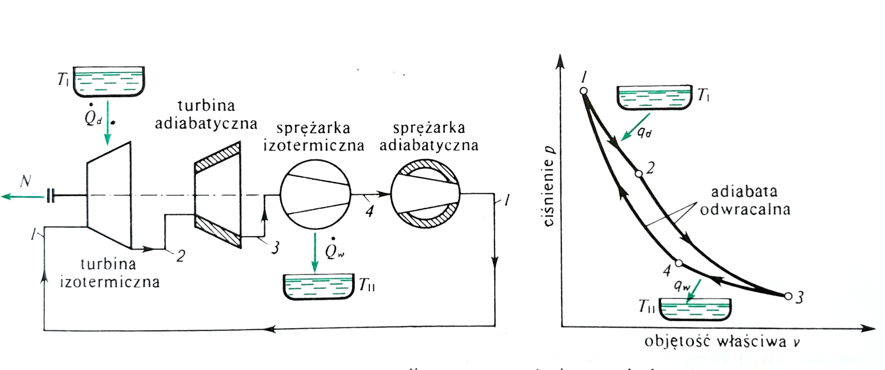

```{r}
#| label: setup
#| include: false

library(ggplot2)
source("../theme/ggtheme.R")   # wspólny styl wykresów i paleta slajdów
theme_set(theme_slides(16))
knitr::opts_chunk$set(dev.args = list(bg = "transparent"))
```

## <i class="bi bi-list-ol"></i> Agenda Wykładu {data-menu-title="Agenda"}

1.  **Ograniczenia I Zasady** (Kierunek Procesów)
2.  **Silniki Cieplne i Pompy Ciepła** (Zasada Działania)
3.  **Sformułowania II Zasady** (Kelvin vs Clausius)
4.  **Procesy Odwracalne i Nieodwracalne**
5.  **Obieg Carnota** (Silnik Idealny)
6.  **Skala Termodynamiczna Temperatury**

## <i class="bi bi-1-circle"></i> 1. Dlaczego I Zasada to za mało?

### Kierunek Procesów

:::: {.columns}

::: {.column width="60%"}
I Zasada Termodynamiki mówi o **zachowaniu energii** (bilans musi wyjść na zero). Ale nie mówi nic o **kierunku** przemian.

::: incremental
*   Dlaczego ciepło płynie samoistnie tylko z ciała cieplejszego do zimniejszego?
*   Dlaczego wrzątek stygnie, ale zimna woda sama się nie zagotuje (pobierając ciepło z otoczenia)?
*   Dlaczego, gdy upuścisz szklankę, rozbija się na kawałki, ale kawałki nigdy same nie złożą się w szklankę?
:::
:::

::: {.column width="40%"}
::: {.callout-important title="Problem"}
I Zasada nie zabrania procesom biec "wstecz", o ile energia się zgadza. Jednak w rzeczywistości tak się nie dzieje. Potrzebujemy II Zasady ("Drogowskazu").
:::
:::

::::

## <i class="bi bi-film"></i> Przykłady Procesów Nieodwracalnych

::: {.panel .panel-blue}
Dlaczego film puszczony od tyłu wygląda nienaturalnie?
:::

::: incremental
1.  **Rozprężanie swobodne gazu:** Gaz wypuszczony z butli do próżni nigdy sam nie wróci do butli, chociaż energia by na to pozwoliła.
2.  **Mieszanie płynów:** Kawa z mlekiem nigdy sama się nie rozdzieli.
3.  **Tarcie:** Tarcie zamienia pracę na ciepło. Ogrzanie klocka hamulcowego nie sprawi, że samochód zacznie jechać.
4.  **Przepływ ciepła:** Ciepło płynie samorzutnie tylko od ciała cieplejszego do zimniejszego ($\Delta T > 0$).
:::

::: {.fragment .callout-note}
Wszystkie te procesy generują **Entropię** (miarę nieporządku), o czym powiemy w W7.
:::

## <i class="bi bi-fire"></i> 2. Źródła Ciepła (Rezerwuary)

::: {.panel .panel-blue}
Aby zbudować silnik, potrzebujemy dwóch źródeł ciepła o dużej pojemności cieplnej (ich temperatura się nie zmienia mimo poboru ciepła):
:::

:::: {.columns}

::: {.column width="60%"}

1.  **Źródło górne ($T_H$):** Piec, Reaktor Jądrowy, Słońce. Dostarcza ciepło $Q_H$ (High).
2.  **Źródło dolne ($T_L$):** Rzeka, Atmosfera, Grunt. Odbiera ciepło odpadowe $Q_L$ (Low).

::: {.panel .panel-amber .fragment}
Podstawą II Zasady jest nieodwracalność samorzutnych procesów przyrody. Zachodzą one od stanu o wyższym potencjale do stanów o potencjale niższym.
:::

:::

::: {.column width="40%"}

```{r}
#| label: silnik-schemat
#| echo: false
#| warning: false
#| fig-width: 5
#| fig-height: 5.6
#| out-width: "80%"
#| fig-align: center

# 1. Źródła (prostokąty) – etykiety w składni plotmath
reservoirs <- data.frame(
  xmin = c(1, 1),
  xmax = c(9, 9),
  ymin = c(8.5, 0.5),
  ymax = c(10, 2),
  fill = c(pal_slides[2], pal_slides[3]),
  label = c(
    "atop('GÓRNE ŹRÓDŁO CIEPŁA', '(Temp. '*T[H]*')')",
    "atop('DOLNE ŹRÓDŁO CIEPŁA', '(Temp. '*T[L]*')')"
  )
)

# 2. Silnik (koło centralne)
engine_center <- data.frame(x = 5, y = 5.25)

# 3. Strzałki przepływu: Q_H (dostarczone), Q_L (odprowadzone), L (praca)
arrows_data <- data.frame(
  x    = c(5,   5,   6.2),
  xend = c(5,   5,   8.5),
  y    = c(8.5, 3.5, 5.25),
  yend = c(7,   2,   5.25),
  color = c(pal_slides[2], pal_slides[3], pal_slides[1]),
  lw    = c(3, 2, 2.5)
)

# 4. Etykiety przepływów
labels_flow <- data.frame(
  x = c(5.5, 5.5, 8.8),
  y = c(7.8, 2.8, 5.7),
  label = c(
    "atop('Ciepło dodane', '(' * Q[H] * ')')",
    "atop('Ciepło oddane', '(' * Q[L] * ')')",
    "atop('Praca', '(' * L * ')')"
  ),
  color = c(pal_slides[2], pal_slides[3], pal_slides[1])
)

ggplot() +
  geom_rect(data = reservoirs,
            aes(xmin = xmin, xmax = xmax, ymin = ymin, ymax = ymax, fill = fill),
            color = col_ink, linewidth = 0.8, show.legend = FALSE) +
  geom_text(data = reservoirs,
            aes(x = (xmin + xmax) / 2, y = (ymin + ymax) / 2, label = label),
            color = "white", fontface = "bold", size = 5, parse = TRUE) +
  geom_segment(data = arrows_data,
               aes(x = x, xend = xend, y = y, yend = yend, color = color, linewidth = lw),
               arrow = arrow(length = unit(0.5, "cm"), type = "closed"),
               show.legend = FALSE) +
  geom_point(data = engine_center, aes(x = x, y = y),
             size = 50, shape = 21, fill = "white", color = col_ink, stroke = 1.5) +
  annotate("text", x = 5, y = 5.25, label = "atop('SILNIK', atop('CIEPLNY', '(Cykl)'))",
           fontface = "bold", size = 5, parse = TRUE, color = col_ink) +
  geom_text(data = labels_flow, aes(x = x, y = y, label = label, color = color),
            hjust = 0, fontface = "bold", size = 4.5, show.legend = FALSE, parse = TRUE) +
  scale_fill_identity() +
  scale_color_identity() +
  scale_linewidth_identity() +
  xlim(0, 10.5) + ylim(0, 10.5) +
  theme_void()
```

:::

::::

## <i class="bi bi-gear-wide-connected"></i> Silnik Cieplny

::: {.panel .panel-blue}
Urządzenie cykliczne, które zamienia ciepło na pracę.
:::

::: incremental
1.  Pobiera ciepło $Q_H$ ze źródła o wysokiej temperaturze ($T_H$).
2.  Zamienia część tego ciepła na pracę użyteczną $L$.
3.  Oddaje pozostałe (niewykorzystane) ciepło $Q_L$ do źródła dolnego ($T_L$).
:::

::: {.fragment}
### Sprawność Termiczna

::: {.panel .panel-amber}
$$ \eta_{th} = \frac{\text{Korzyść}}{\text{Koszt}} = \frac{L}{Q_H} = \frac{Q_H - Q_L}{Q_H} = 1 - \frac{Q_L}{Q_H} $$
:::
:::

## <i class="bi bi-snow"></i> Chłodziarka i Pompa Ciepła

::: {.panel .panel-blue}
To "odwrócony" silnik cieplny.
:::

:::: {.columns}

::: {.column width="50%"}
::: incremental
1.  Pobiera ciepło $Q_L$ z zimnego wnętrza ($T_L$).
2.  Wymaga dostarczenia pracy $L$ (sprężarka).
3.  Oddaje ciepło $Q_H$ do ciepłego otoczenia ($T_H$).
:::
:::

::: {.column width="50%"}
::: {.fragment}
### Współczynniki Efektywności (COP)

::: {.panel .panel-amber}
*   **Chłodziarka:** Cel to $Q_L$.
    $$ \text{COP}_R = \frac{Q_L}{L} $$
*   **Pompa Ciepła:** Cel to $Q_H$ (ogrzewanie).
    $$ \text{COP}_{HP} = \frac{Q_H}{L} = \text{COP}_R + 1 $$
:::
:::
:::

::::

## <i class="bi bi-calculator"></i> Przykład Obliczeniowy: Silnik

::: {.panel .panel-green}
Załóżmy, że silnik pobiera $Q_H = 100 \text{ kJ}$ ciepła z pieca i wykonuje $L = 30 \text{ kJ}$ pracy.
:::

::: incremental
1.  **Ile ciepła oddaje do otoczenia ($Q_L$)?**
    $$ Q_L = Q_H - L = 100 - 30 = 70 \text{ kJ} $$

2.  **Jaka jest sprawność termiczna ($\eta_{th}$)?**
    $$ \eta_{th} = \frac{L}{Q_H} = \frac{30}{100} = 0{,}30 = 30\% $$
:::

::: {.fragment .callout-tip title="**Wniosek:**"}
Większość energii (70%) jest marnowana jako ciepło odpadowe! To typowa wartość dla silników spalinowych.
:::

## <i class="bi bi-speedometer2"></i> Analiza COP (Współczynnik Wydajności)

::: {.panel .panel-green}
Dlaczego $\text{COP}$ może być większe od 1 (np. 3 lub 4)?
Czy to perpetuum mobile? [**NIE!**]{.fragment .answer}
:::

::: incremental
*   Pompujemy ciepło, a nie je wytwarzamy.
*   Płacimy pracą ($L$) tylko za przenoszenie energii.
$$ \text{COP}_{HP} = \frac{Q_H}{L} = \frac{Q_L + L}{L} = \frac{Q_L}{L} + 1 = \text{COP}_R + 1 $$
:::

::: {.fragment .callout-tip title="**Wniosek:**"}
Jeśli $\text{COP}_{HP} = 4$, to za każde 1 kWh prądu otrzymujemy 4 kWh ciepła w domu (1 kWh z prądu + 3 kWh z darmowego powietrza na zewnątrz).
:::

## <i class="bi bi-chat-quote"></i> 3. Sformułowania II Zasady {.smaller}

:::: {.columns}

::: {.column width="50%"}
### Sformułowanie Kelvina-Plancka

::: {.panel .panel-blue .fragment}
> Nie jest możliwy proces cykliczny, którego **jedynym** wynikiem byłoby pobranie ciepła ze źródła i zamiana go w całości na pracę.
:::

::: {.fragment .callout-tip title="**Wniosek:**"}
**Silnik o sprawności 100% jest niemożliwy.**

Musimy oddać część ciepła $Q_L$ do chłodnicy: [$Q_L \neq 0$.]{.answer}
:::
:::

::: {.column width="50%"}
### Sformułowanie Clausiusa

::: {.panel .panel-blue .fragment}
> Nie jest możliwe zbudowanie urządzenia, którego **jedynym** skutkiem byłoby przeniesienie ciepła z ciała zimnego do ciała ciepłego.
:::

::: {.fragment .callout-tip title="**Wniosek:**"}
**Chłodziarka wymaga doprowadzenia energii z zewnątrz** — pracy (sprężarka) lub ciepła o wysokiej temperaturze (chłodziarka absorpcyjna). Ciepło nie popłynie "pod górę" samoistnie.
:::
:::

::::

## <i class="bi bi-arrow-left-right"></i> Równoważność Sformułowań

::: {.panel .panel-green}
Te dwa twierdzenia brzmią różnie, ale są równoważne.

Złamanie jednego oznacza złamanie też drugiego.
:::

::: incremental

*   Gdyby silnik był w 100% sprawny (łamie K-P), można by nim zasilić pompę ciepła, co w rezultacie pompowałoby ciepło z zimnego do ciepłego bez udziału pracy z zewnątrz (łamie Clausiusa).
*   I odwrotnie: gdyby urządzenie przenosiło ciepło z zimnego do ciepłego bez pracy (łamie Clausiusa), można by nim przenosić z powrotem do źródła górnego całe ciepło $Q_L$, które zwykły silnik oddaje do źródła dolnego. Źródło dolne nie zmienia stanu, a ciepło netto $Q_H - Q_L$ pobrane ze źródła górnego zamienia się w całości na pracę (łamie K-P).

:::

## <i class="bi bi-slash-circle"></i> Perpetuum Mobile II Rodzaju

::: {.panel .panel-blue}
Urządzenie, które łamie II Zasadę Termodynamiki (Sformułowanie Kelvina-Plancka).
:::

:::: {.columns}

::: {.column width="40%"}
Wyobraźmy sobie statek, który pobiera ciepło z oceanu ($T \approx 15^\circ\text{C}$) i zamienia je w całości na napęd.

*   I Zasada? **Spełniona** (Energia z wody $\to$ Praca).
*   II Zasada? **Złamana** (Brak $Q_L$, $\eta = 100\%$).

::: {.panel .panel-amber}
**NIEMOŻLIWE:** $Q_H \to [\text{SILNIK}] \to L$ (brak strzałki $Q_L$).
:::
:::

::: {.column width="60%"}

```{r}
#| label: statek
#| echo: false
#| warning: false
#| fig-width: 8
#| fig-height: 4.6
#| out-width: "85%"
#| fig-align: center

# --- 1. Geometria ---
ocean <- data.frame(xmin = 0, xmax = 12, ymin = 0, ymax = 3.5)

# kadłub nieco nad linią wody (y = 3.5), żeby horyzont nie pokrywał się z pokładem
ship_hull <- data.frame(
  x = c(1, 11, 10, 2),
  y = c(4.1, 4.1, 2.1, 2.1)
)
ship_cabin <- data.frame(xmin = 3, xmax = 6, ymin = 4.1, ymax = 6.1)
ship_stack <- data.frame(xmin = 4, xmax = 5, ymin = 6.1, ymax = 7.1)

# --- 2. Strzałki energetyczne: ciepło pobrane (pomarańcz), praca (niebieski) ---
arrows <- data.frame(
  x_start = c(6, 8),
  y_start = c(2.1, 5.1),
  x_end   = c(6, 13),
  y_end   = c(4.1, 5.1),
  color   = c(pal_slides[2], pal_slides[1]),
  lw      = c(2, 2)
)

labels_arrows <- data.frame(
  x = c(6.2, 10.5),
  y = c(3.1, 5.8),
  label = c("Pobór ciepła\n(Q z oceanu)", "Całkowita zamiana\nna NAPĘD (L = Q)"),
  color = c(pal_slides[2], pal_slides[1])
)

# --- 3. Znak zakazu ---
forbidden_mark <- data.frame(
  x = c(1, 1), xend = c(11, 11),
  y = c(1, 8), yend = c(8, 1)
)

ggplot() +
  # Ocean
  geom_rect(data = ocean, aes(xmin = xmin, xmax = xmax, ymin = ymin, ymax = ymax),
            fill = pal_slides[1], alpha = 0.3) +
  annotate("text", x = 2, y = 0.6, label = "OCEAN (T ≈ 15°C)\n(jedyne źródło ciepła)",
           color = col_ink, fontface = "bold", hjust = 0, size = 5, lineheight = 0.9) +
  # Statek
  geom_polygon(data = ship_hull, aes(x = x, y = y), fill = "#bdb9b2", color = col_ink) +
  geom_rect(data = ship_cabin, aes(xmin = xmin, xmax = xmax, ymin = ymin, ymax = ymax),
            fill = "white", color = col_ink) +
  geom_rect(data = ship_stack, aes(xmin = xmin, xmax = xmax, ymin = ymin, ymax = ymax),
            fill = col_ink2, color = col_ink) +
  annotate("text", x = 4.5, y = 5.1, label = "SILNIK\nSTATKU", fontface = "bold", size = 4,
           color = col_ink, lineheight = 0.9) +
  # Strzałki przepływu
  geom_segment(data = arrows,
               aes(x = x_start, xend = x_end, y = y_start, yend = y_end, color = color, linewidth = lw),
               arrow = arrow(length = unit(0.6, "cm"), type = "closed"), show.legend = FALSE) +
  geom_text(data = labels_arrows, aes(x = x, y = y, label = label, color = color),
            fontface = "bold", size = 5, hjust = 0, show.legend = FALSE, lineheight = 0.9) +
  # Znak zakazu
  geom_segment(data = forbidden_mark, aes(x = x, xend = xend, y = y, yend = yend),
               color = pal_slides[8], linewidth = 3, alpha = 0.5, lineend = "round") +
  # Tytuły
  annotate("text", x = 6, y = 8.6, label = "PERPETUUM MOBILE II RODZAJU",
           color = pal_slides[8], fontface = "bold", size = 7) +
  annotate("text", x = 6, y = 7.8,
           label = "(niemożliwe wg II Zasady Termodynamiki:\nbrak dolnego źródła ciepła!)",
           color = col_ink2, fontface = "italic", size = 5, lineheight = 0.9) +
  scale_color_identity() +
  scale_linewidth_identity() +
  xlim(0, 14) + ylim(0, 9) +
  theme_void()
```

::: {.fragment .callout-caution appearance="simple"}
Takie urządzenie nie narusza bilansu energii, ale jest niemożliwe fizycznie.
:::

:::

::::

## <i class="bi bi-recycle"></i> 4. Procesy Odwracalne i Nieodwracalne

:::: {.columns}

::: {.column width="50%"}
### Proces Odwracalny

::: {.panel .panel-green}
Można go cofnąć bez śladu w otoczeniu.
:::

::: {.mmd-fit style="height: 320px;"}
```{mermaid}
%%{init: {'theme': 'default', 'flowchart': {'htmlLabels': false, 'curve': 'basis', 'wrappingWidth': 400, 'subGraphTitleMargin': {'top': 6, 'bottom': 16}}, 'themeVariables': {'fontSize': '16px', 'fontFamily': 'Arial, Helvetica, sans-serif', 'primaryColor': '#ffffff', 'edgeLabelBackground': '#ffffff', 'tertiaryColor': '#fff4e3'}, 'htmlLabels': false}}%%
flowchart LR
    A((Stan 1)) <==> B((Stan 2))

    style A fill:#ecf7ee,stroke:#1f9d55,stroke-width:4px
    style B fill:#ecf7ee,stroke:#1f9d55,stroke-width:4px
    linkStyle 0 stroke:#1f9d55,stroke-width:4px
```
:::
:::

::: {.column width="50%"}
### Proces Nieodwracalny

::: {.panel .panel-amber}
Układ można przywrócić do stanu początkowego tylko kosztem trwałych zmian w otoczeniu (np. zużycia pracy).
:::

::: {.mmd-fit style="height: 320px;"}
```{mermaid}
%%{init: {'theme': 'default', 'flowchart': {'htmlLabels': false, 'curve': 'basis', 'wrappingWidth': 400, 'subGraphTitleMargin': {'top': 6, 'bottom': 16}}, 'themeVariables': {'fontSize': '16px', 'fontFamily': 'Arial, Helvetica, sans-serif', 'primaryColor': '#ffffff', 'edgeLabelBackground': '#ffffff', 'tertiaryColor': '#fff4e3'}, 'htmlLabels': false}}%%
flowchart LR
    C((Stan 1)) ==> D((Stan 2))
    D -.-> |Praca| C

    style C fill:#fff4e3,stroke:#eb6834,stroke-width:4px
    style D fill:#fff4e3,stroke:#eb6834,stroke-width:4px
    linkStyle 0 stroke:#eb6834,stroke-width:4px
    linkStyle 1 stroke:#eb6834,stroke-width:3px
```
:::
:::

::::

## <i class="bi bi-exclamation-triangle"></i> Źródła Nieodwracalności

::: {.panel .panel-amber}
Co sprawia, że procesu nie da się cofnąć bez strat?
:::

::: incremental
1.  **Tarcie** (Ciał stałych i lepkość płynów) - zamiana pracy na ciepło jest jednostronna.
2.  **Nierównowaga sił** (Gwałtowne rozprężanie) - ciśnienie wewnętrzne jest znacznie wyższe niż zewnętrzne.
3.  **Wymiana ciepła przy skończonym $\Delta T$** - im większa różnica temperatur, tym większa nieodwracalność.
4.  **Reakcje chemiczne** - spalanie jest wysoce nieodwracalne (nie da się odzyskać paliwa ze spalin przez ogrzanie).
5.  **Opór elektryczny** - przepływ prądu zawsze generuje ciepło Joule'a.
:::

## <i class="bi bi-clock-history"></i> Proces Kwazistatyczny i Warunki Odwracalności

::: {.panel .panel-amber}
Aby proces był odwracalny, układ musi przechodzić przez ciąg stanów równowagi (proces kwazistatyczny) **bez dyssypacji** (tarcia). Powolny proces z tarciem nie jest kwazistatyczny (por. W1).
:::

::: incremental

*   Dzieje się to "nieskończenie powoli" — w każdym momencie $p_{\text{układu}} \approx p_{\text{otoczenia}}$ (równowaga mechaniczna).
*   **Odwracalność wewnętrzna:** brak tarcia i innych efektów dyssypacyjnych wewnątrz układu.
*   **Odwracalność zewnętrzna:** wymiana ciepła przy $T_{\text{układu}} \approx T_{\text{otoczenia}}$ (nieskończenie małe $\Delta T$), brak tarcia poza układem.
*   Proces **całkowicie odwracalny** jest odwracalny wewnętrznie i zewnętrznie.

:::

::: {.fragment}
Taki proces to **idealizacja** (jak punkt materialny w mechanice). Służy do wyznaczenia teoretycznych granic wydajności.
:::

## <i class="bi bi-arrow-repeat"></i> 5. Obieg Carnota: Wzorzec Doskonałości

Sadi Carnot (1824) wymyślił najbardziej sprawny możliwy silnik, działający między dwoma temperaturami $T_H$ i $T_L$. Składa się z 4 procesów **odwracalnych**:

:::: {.columns}

::: {.column width="50%"}
::: {.panel .panel-blue}
::: incremental
1.  **Izotermiczne rozprężanie** (w $T_H$): Pobranie ciepła $Q_H$.
2.  **Adiabatyczne rozprężanie:** Temperatura spada z $T_H$ do $T_L$. Praca wykonana kosztem energii wewn.
3.  **Izotermiczne sprężanie** (w $T_L$): Oddanie ciepła $Q_L$.
4.  **Adiabatyczne sprężanie:** Temperatura rośnie z $T_L$ do $T_H$.
:::
:::
:::

::: {.column width="50%"}
{fig-align="center" width="100%"}

::: {.small-note}
Źródło: *Termodynamika techniczna*, 2000, J. Szargut.
Oznaczenia na rysunku: $T_{\text{I}} = T_H$, $T_{\text{II}} = T_L$; $\dot{Q}_d$, $q_d$ — ciepło doprowadzone ($Q_H$); $\dot{Q}_w$, $q_w$ — ciepło wyprowadzone ($Q_L$); $N$ — moc (praca $L$ w jednostce czasu).
:::
:::

::::

## <i class="bi bi-arrow-repeat"></i> Obieg Carnota – 1-2: Rozprężanie Izotermiczne

::: {.panel .panel-amber}
*   **Stan:** Kontakt ze źródłem górnym $T_H$.
*   **Proces:** Gaz rozpręża się powoli, wykonując pracę na tłoku.
*   **Energia:** Aby $T=const$, gaz musi pobrać ciepło $Q_H$.
*   **Entropia:** Rośnie (dostarczamy ciepło).
:::

## <i class="bi bi-arrow-repeat"></i> Obieg Carnota – 2-3: Rozprężanie Adiabatyczne

::: {.panel .panel-blue}
*   **Stan:** Izolacja termiczna (brak wymiany ciepła).
*   **Proces:** Dalsze rozprężanie kosztem energii wewnętrznej.
*   **Efekt:** Temperatura spada z $T_H$ do $T_L$.
*   **Entropia:** Stała ($dQ=0$, proces odwracalny).
:::

## <i class="bi bi-arrow-repeat"></i> Obieg Carnota – 3-4: Sprężanie Izotermiczne

::: {.panel .panel-green}
*   **Stan:** Kontakt ze źródłem dolnym $T_L$.
*   **Proces:** Tłok spręża gaz (praca zewnętrzna).
*   **Energia:** Aby $T=const$ (gaz nie ogrzewa się), musimy oddać ciepło $Q_L$.
*   **Entropia:** Maleje (oddajemy ciepło).
:::

## <i class="bi bi-arrow-repeat"></i> Obieg Carnota – 4-1: Sprężanie Adiabatyczne

::: {.panel .panel-blue}
*   **Stan:** Izolacja termiczna.
*   **Proces:** Dalsze sprężanie podnosi temperaturę.
*   **Efekt:** Temperatura wraca z $T_L$ do $T_H$. Zamykamy cykl.
*   **Entropia:** Stała.
:::

## <i class="bi bi-graph-up"></i> Wizualizacja Obiegu Carnota (T-s)

:::: {.columns}

::: {.column width="45%"}
Na wykresie T-s (Temperatura-Entropia) obieg Carnota to idealny **prostokąt**.

*   Izotermy ($T=const$): Poziome.
*   Adiabaty odwracalne ($s=const$): Pionowe.

::: {.panel .panel-amber style="text-align: center;"}
$$ \eta_{\text{Carnot}} = 1 - \frac{T_L}{T_H} $$
:::

To maksymalna teoretyczna sprawność maszyny cieplnej.
:::

::: {.column width="55%"}
```{r}
#| label: fig-carnot-ts
#| fig-cap: "Obieg Carnota na wykresie T-s"
#| echo: false
#| warning: false
#| fig-width: 7.5
#| fig-height: 5
#| out-width: "95%"
#| fig-align: center

df_carnot <- data.frame(
  s = c(1, 4, 4, 1),
  T = c(600, 600, 300, 300),
  Label = c("1", "2", "3", "4")
)

ggplot(df_carnot, aes(x = s, y = T)) +
  # Pole obiegu = praca (podkładka w kolorze pracy)
  geom_polygon(fill = pal_slides[1], alpha = 0.12, color = col_ink, linewidth = 1.1) +
  # Izoterma górna: ciepło dostarczone; izoterma dolna: ciepło odprowadzone
  annotate("segment", x = 1, xend = 4, y = 600, yend = 600, color = pal_slides[2], linewidth = 1.8) +
  annotate("segment", x = 4, xend = 1, y = 300, yend = 300, color = pal_slides[3], linewidth = 1.8) +
  # Punkty 1–4
  geom_text(aes(label = Label), nudge_x = c(-0.15, 0.15, 0.15, -0.15),
            nudge_y = c(22, 22, -22, -22), size = 6, fontface = "bold", color = col_ink) +
  annotate("text", x = 2.5, y = 450,
           label = "atop('Ciepło zamienione na pracę', L == Q[H] - Q[L])",
           fontface = "bold", color = pal_slides[1], size = 5.5, parse = TRUE) +
  annotate("text", x = 2.5, y = 640,
           label = "'Pobieranie ' * Q[H] * ' (izoterma ' * T[H] * ')'",
           color = pal_slides[2], size = 5, parse = TRUE) +
  annotate("text", x = 2.5, y = 260,
           label = "'Oddawanie ' * Q[L] * ' (izoterma ' * T[L] * ')'",
           color = pal_slides[3], size = 5, parse = TRUE) +
  scale_x_continuous(limits = c(0.5, 4.5)) +
  scale_y_continuous(limits = c(220, 680)) +
  labs(
    x = expression("Entropia " * s ~ "[kJ/(kg·K)]"),
    y = expression("Temperatura " * T ~ "[K]")
  ) +
  theme_slides(16)
```
:::

::::

## <i class="bi bi-lightbulb"></i> Wnioski z Carnota

::: {.panel .panel-amber style="text-align: center;"}
$$ \eta = 1 - \frac{T_L}{T_H} $$
:::

::: incremental
1.  **Sprawność zależy tylko od temperatur.** Nie zależy od czynnika roboczego (powietrze, para, hel - bez znaczenia).
2.  **Im wyższa $T_H$, tym lepiej.** Dlatego w elektrowniach dążymy do jak najwyższych temperatur pary (np. $600^\circ\text{C}$).
3.  **Im niższa $T_L$, tym lepiej.** Ale jesteśmy ograniczeni temperaturą otoczenia (ok. $20^\circ\text{C} \approx 293\text{ K}$).
4.  **$\eta < 100\%$:** Aby mieć $\eta=1$, musielibyśmy mieć $T_L = 0\text{ K}$ (niemożliwe).
:::

## <i class="bi bi-thermometer-sun"></i> Potrzeba Niezależnej Skali Temperatury

::: {.panel .panel-blue}
Tradycyjne termometry (rtęciowe, alkoholowe) zależą od właściwości substancji.
:::

::: incremental
*   Rozszerzalność rtęci nie jest idealnie liniowa w każdej temperaturze.
*   Różne termometry mogą wskazywać nieco inne wartości.

:::

::: {.fragment}
**Potrzebujemy skali uniwersalnej**, niezależnej od użytego materiału.
Taką skalę daje nam II Zasada Termodynamiki i Silnik Carnota.
:::

## <i class="bi bi-thermometer-half"></i> Termodynamiczna Skala Temperatury (Kelvina)

::: {.panel .panel-blue}
Lord Kelvin zaproponował definicję temperatury opartą na sprawności silnika Carnota:
:::

::: {.panel .panel-amber style="text-align: center;"}
$$ \frac{Q_H}{Q_L} = \frac{T_H}{T_L} $$
:::

::: incremental
*   Stosunek temperatur jest równy stosunkowi ciepła wymienianego w obiegu odwracalnym.
*   Skala ta nie zależy od czynnika roboczego.
*   **Zero absolutne ($0\text{ K}$):** Teoretyczny stan, w którym silnik Carnota miałby sprawność 100% (nie oddawałby ciepła $Q_L=0$).

:::

::: {.fragment .callout-note}
Kelwin (K) jest jednostką podstawową układu SI. $T(\text{K}) = t(^\circ\text{C}) + 273{,}15$.
:::

## <i class="bi bi-clipboard-check"></i> Podsumowanie W6

1.  **II Zasada:** Energia ma jakość. Procesy rzeczywiste są nieodwracalne (tarcie, $\Delta T$).
2.  **Silniki:** Nie ma silnika o sprawności 100% (Kelvin-Planck).
3.  **Pompy Ciepła:** Wymagają pracy, by transportować ciepło "pod górę" (Clausius).
4.  **Carnot:** Wyznacza teoretyczną granicę sprawności ($\eta = 1 - T_L/T_H$).
5.  **Skala Termodynamiczna:** Definiuje temperaturę niezależnie od substancji.

### Zapowiedź W7
W kolejnym wykładzie zajmiemy się matematycznym opisem nieporządku - **Entropią**.
