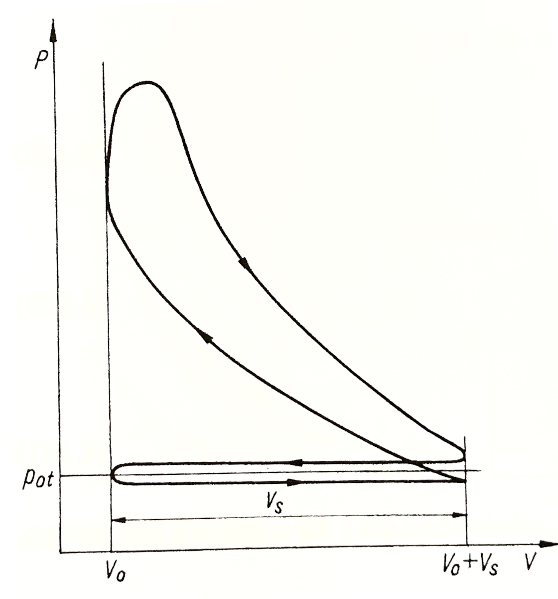
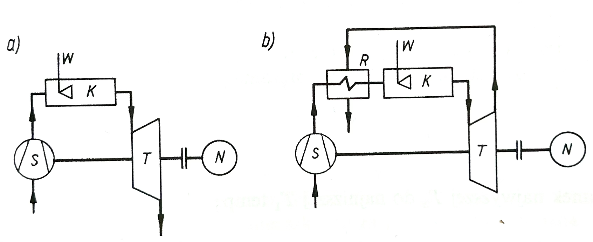

```{r}
#| label: setup
#| include: false
library(ggplot2)
library(patchwork)
source("../theme/ggtheme.R")   # wspólny styl wykresów i paleta slajdów
theme_set(theme_slides(16))
knitr::opts_chunk$set(dev.args = list(bg = "transparent"))

# Stałe modelu (standard powietrzny)
k <- 1.4; cv <- 0.718; R_ind <- 0.287

# Kolory semantyczne przemian obiegu
col_proc <- c("Sprężanie / rozprężanie (s = const)" = pal_slides[1],
              "Doprowadzenie ciepła"                = pal_slides[2],
              "Odprowadzenie ciepła"                = pal_slides[3])

# Odcinek obiegu (wektory v i p) z przypisaną przemianą
seg <- function(v, p, proc) data.frame(v = v, p = p, proc = proc)

# Składa obieg z odcinków, liczy T i s (jednostki umowne) oraz punkty węzłowe
build_cycle <- function(segs, labs) {
  df <- do.call(rbind, segs)
  df$T <- df$p * df$v
  df$s <- cv * log(df$T) + R_ind * log(df$v)
  df$s <- df$s - min(df$s)
  df$proc <- factor(df$proc, levels = names(col_proc))
  idx <- cumsum(c(1, head(sapply(segs, nrow), -1)))
  pts <- df[idx, ]
  pts$lab <- labs
  list(df = df, pts = pts)
}

# Para wykresów p-v i T-s ze wspólną legendą
cycle_plots <- function(cyc, pv_h, pv_v, ts_h, ts_v) {
  df <- cyc$df; pts <- cyc$pts
  pts$pv_h <- pv_h; pts$pv_v <- pv_v; pts$ts_h <- ts_h; pts$ts_v <- ts_v
  base <- list(
    scale_colour_manual(values = col_proc, breaks = names(col_proc), drop = FALSE),
    scale_x_continuous(breaks = NULL, expand = expansion(mult = 0.15)),
    scale_y_continuous(breaks = NULL, expand = expansion(mult = 0.18)),
    coord_cartesian(clip = "off"),
    theme_slides(16),
    theme(plot.title = element_text(size = 15, colour = col_ink2),
          legend.text = element_text(size = 13))
  )
  p_pv <- ggplot(df, aes(v, p)) +
    geom_path(aes(colour = proc, group = 1), linewidth = 1.1, lineend = "round") +
    geom_text(data = pts, aes(v, p, label = lab, hjust = pv_h, vjust = pv_v),
              size = 5.5, fontface = "bold", colour = col_ink) +
    labs(title = "Wykres p-v", x = "Objętość właściwa v", y = "Ciśnienie p", colour = NULL) +
    base
  p_ts <- ggplot(df, aes(s, T)) +
    geom_path(aes(colour = proc, group = 1), linewidth = 1.1, lineend = "round") +
    geom_text(data = pts, aes(s, T, label = lab, hjust = ts_h, vjust = ts_v),
              size = 5.5, fontface = "bold", colour = col_ink) +
    labs(title = "Wykres T-s", x = "Entropia właściwa s", y = "Temperatura T", colour = NULL) +
    base
  (p_pv + p_ts) + plot_layout(guides = "collect") & theme(legend.position = "bottom")
}
```

## <i class="bi bi-list-ol"></i> Agenda Wykładu {data-menu-title="Agenda"}

1.  **Standard Powietrzny** (Założenia)
2.  **Parametry Geometryczne** (Stopień sprężania)
3.  **Obieg Otto** (Silnik benzynowy)
4.  **Obieg Diesla** (Silnik wysokoprężny)
5.  **Obieg Sabathé** (Silnik wysokoprężny)
6.  **Obieg Joule'a-Braytona** (Turbina Gazowa)
7.  **Średnie Ciśnienie Użyteczne** ($p_{me}$)

## <i class="bi bi-bookmark-star"></i> 1. Standard Powietrzny

::: {.panel .panel-blue}
**Rzeczywisty proces spalania** jest skomplikowany (zmiana składu chemicznego, tarcie).
W termodynamice stosujemy model uproszczony (**Air-Standard Assumptions**):
:::

::: {.incremental}
1.  Czynnik roboczy to **powietrze** (gaz doskonały).
2.  Obieg jest **zamknięty** (nie ma wymiany ładunku).
3.  Spalanie zastępujemy **doprowadzeniem ciepła** ze źródła zewnętrznego.
4.  Wydech zastępujemy **odprowadzeniem ciepła** (chłodzeniem).
5.  Wszystkie procesy są odwracalne.
:::

## <i class="bi bi-recycle"></i> Definicja Procesu Cyklicznego

::: {.panel .panel-blue}
**Obieg termodynamiczny (cykl)** to proces, w którym stan końcowy czynnika jest identyczny z początkowym.
:::

::: {.incremental}
*   Zmiana funkcji stanu (energii wewnętrznej, entropii) w pełnym cyklu wynosi zero:
    $$ \oint dU = 0, \quad \oint dS = 0 $$
*   Z I Zasady Termodynamiki wynika, że praca netto obiegu równa jest ciepłu netto:
    $$ L_{ob} = Q_{\text{netto}} = Q_{dop} - |Q_{wyp}| $$
:::

## <i class="bi bi-gear"></i> 2. Geometria Silnika

::::: columns
::: {.column width="50%"}
Kluczowe parametry:

::: {.incremental}
1.  **GMP (TDC):** Górny Martwy Punkt (min objętość, $V_{min}$).
2.  **DMP (BDC):** Dolny Martwy Punkt (max objętość, $V_{max}$).
3.  **Objętość skokowa ($V_s$):** $V_{max} - V_{min}$.
:::
:::

::: {.column width="50%"}
::: {.panel .panel-amber .fragment}
**Stopień sprężania ($\varepsilon$)** – najważniejszy parametr decydujący o sprawności!

$$ \varepsilon = \frac{V_{max}}{V_{min}} $$
:::

::: incremental
*   Silniki benzynowe: $\varepsilon = 8\text{–}12$.
*   Diesle: $\varepsilon = 14\text{–}24$.
:::
:::
:::::

## <i class="bi bi-speedometer2"></i> 3. Obieg Otto (Zapłon Iskrowy - ZI)

::: {.panel .panel-blue}
**Model silnika benzynowego.** Mieszanka paliwowo-powietrzna jest sprężana, a potem zapalana iskrą.
:::

Procesy:

::: incremental
1.  **1-2:** Sprężanie izentropowe ($s=const$).
2.  **2-3:** Doprowadzenie ciepła przy **stałej objętości** ($v=const$) - "Eksplozja".
3.  **3-4:** Rozprężanie izentropowe (Praca).
4.  **4-1:** Odprowadzanie ciepła przy **stałej objętości** (Wydech).
:::

## <i class="bi bi-percent"></i> Otto: Wykres i Sprawność

:::: {.columns}
::: {.column width="62%"}
```{r}
#| label: otto
#| echo: false
#| warning: false
#| message: false
#| fig-width: 8
#| fig-height: 3.9
#| out-width: "100%"
#| fig-align: center

v_min <- 1; v_max <- 8; lambda <- 3.5; n <- 50
p1 <- 1; v1 <- v_max
v2 <- v_min; p2 <- p1 * (v1 / v2)^k
v3 <- v2;    p3 <- p2 * lambda
v4 <- v1;    p4 <- p3 * (v3 / v4)^k

v_12 <- seq(v1, v2, length.out = n); v_34 <- seq(v3, v4, length.out = n)
otto <- build_cycle(list(
  seg(v_12, p1 * (v1 / v_12)^k,          "Sprężanie / rozprężanie (s = const)"),
  seg(rep(v2, n), seq(p2, p3, length.out = n), "Doprowadzenie ciepła"),
  seg(v_34, p3 * (v3 / v_34)^k,          "Sprężanie / rozprężanie (s = const)"),
  seg(rep(v4, n), seq(p4, p1, length.out = n), "Odprowadzenie ciepła")
), labs = c("1", "2", "3", "4"))

cycle_plots(otto,
            pv_h = c(0.5, 1.6, 1.6, 0.5), pv_v = c(1.6, 0.5, 0.5, -0.8),
            ts_h = c(0.5, 0.5, 0.5, 0.5), ts_v = c(1.6, -0.8, -0.8, 1.6))
```
:::

::: {.column width="38%"}
::: {.panel .panel-amber .panel-center}
$$ \eta_{\text{Otto}} = 1 - \frac{1}{\varepsilon^{\kappa-1}} $$
:::

::: {.incremental style="font-size: 0.8em;"}
1.  **1-2:** Sprężanie izentropowe ($s=const$).
2.  **2-3:** Doprowadzenie ciepła przy **stałej objętości** ($v=const$) - "Eksplozja".
3.  **3-4:** Rozprężanie izentropowe (Praca).
4.  **4-1:** Odprowadzanie ciepła przy **stałej objętości** (Wydech).
:::
:::
::::

::: {.fragment .callout-important title="Wniosek:"}
Im wyższy stopień sprężania, tym wyższa sprawność.
Ograniczenie: Spalanie stukowe (samozapłon niespalonej części mieszanki przed frontem płomienia).
:::

## <i class="bi bi-truck"></i> 4. Obieg Diesla (Zapłon Samoczynny - ZS)

::: {.panel .panel-blue}
**Model silnika wysokoprężnego.** Sprężamy samo powietrze (do bardzo wysokiej temperatury), a potem wtryskujemy paliwo.
:::

::: {.callout-tip appearance="simple"}
Różnica: Paliwo pali się wolniej, w miarę jak tłok idzie w dół.
Dlatego spalanie modelujemy jako **Izobarę** ($p=const$).
:::

Procesy:

::: incremental
1.  **1-2:** Sprężanie izentropowe.
2.  **2-3:** Doprowadzenie ciepła przy **stałym ciśnieniu** ($p=const$).
3.  **3-4:** Rozprężanie izentropowe.
4.  **4-1:** Odprowadzanie ciepła przy **stałej objętości**.
:::

## <i class="bi bi-graph-up"></i> Diesel: Wykres

:::: {.columns}
::: {.column width="62%"}
```{r}
#| label: diesel
#| echo: false
#| warning: false
#| message: false
#| fig-width: 8
#| fig-height: 3.9
#| out-width: "100%"
#| fig-align: center

v_min <- 1; v_max <- 18; rho <- 2.5; n <- 50
p1 <- 1; v1 <- v_max
v2 <- v_min; p2 <- p1 * (v1 / v2)^k
p3 <- p2;    v3 <- v_min * rho
v4 <- v1;    p4 <- p3 * (v3 / v4)^k

v_12 <- seq(v1, v2, length.out = n); v_34 <- seq(v3, v4, length.out = n)
diesel <- build_cycle(list(
  seg(v_12, p1 * (v1 / v_12)^k,                "Sprężanie / rozprężanie (s = const)"),
  seg(seq(v2, v3, length.out = n), rep(p2, n), "Doprowadzenie ciepła"),
  seg(v_34, p3 * (v3 / v_34)^k,                "Sprężanie / rozprężanie (s = const)"),
  seg(rep(v4, n), seq(p4, p1, length.out = n), "Odprowadzenie ciepła")
), labs = c("1", "2", "3", "4"))

cycle_plots(diesel,
            pv_h = c(0.5, 1.6, -0.6, 0.5), pv_v = c(1.6, 0.5, 0.5, -0.8),
            ts_h = c(0.5, 0.5, 0.5, 0.5),  ts_v = c(1.6, -0.8, -0.8, 1.6))
```
:::

::: {.column width="38%"}
::: {.incremental style="font-size: 0.8em;"}
1.  **1-2:** Sprężanie izentropowe.
2.  **2-3:** Doprowadzenie ciepła przy **stałym ciśnieniu** ($p=const$).
3.  **3-4:** Rozprężanie izentropowe.
4.  **4-1:** Odprowadzanie ciepła przy **stałej objętości**.
:::
:::
::::

## <i class="bi bi-percent"></i> Sprawność Diesla

Zależy od stopnia obciążenia silnika ($\varphi = V_3/V_2$).

::: {.panel .panel-amber .panel-center}
$$ \eta_{\text{Diesel}} = 1 - \frac{1}{\varepsilon^{\kappa-1}} \left[ \frac{\varphi^\kappa - 1}{\kappa(\varphi - 1)} \right] $$
:::

gdzie: stopień obciążenia – $\varphi = \frac{V_3}{V_2}=\frac{v_3}{v_2}=\frac{T_3}{T_2}$, wykładnik adiabaty – $\kappa=\frac{c_p}{c_v}$

::: {.incremental}
*   Człon w nawiasie jest zawsze $> 1$.
*   Dla tego samego stopnia sprężania $\varepsilon$, Otto jest sprawniejszy niż Diesel!
*   ALE: Diesle mogą pracować na znacznie wyższym $\varepsilon$ (brak spalania stukowego), więc w praktyce są sprawniejsze.
:::

## <i class="bi bi-bezier2"></i> 5. Obieg Sabathé (Obieg Mieszany)

::: {.panel .panel-blue}
**Obieg ogólny silników tłokowych.** Ciepło doprowadzone jest w dwóch etapach: częściowo przy $v=const$, a częściowo przy $p=const$.
:::

:::: {.columns}
::: {.column width="62%"}
```{r}
#| label: sabathe
#| echo: false
#| warning: false
#| message: false
#| fig-width: 8
#| fig-height: 3.8
#| out-width: "100%"
#| fig-align: center

v_min <- 1; v_max <- 16; alfa <- 1.5; rho <- 1.5; n <- 50
p1 <- 1; v1 <- v_max
v2 <- v_min; p2 <- p1 * (v1 / v2)^k
v2a <- v2;   p2a <- p2 * alfa
p3 <- p2a;   v3 <- v2a * rho
v4 <- v1;    p4 <- p3 * (v3 / v4)^k

v_12 <- seq(v1, v2, length.out = n); v_34 <- seq(v3, v4, length.out = n)
sab <- build_cycle(list(
  seg(v_12, p1 * (v1 / v_12)^k,                  "Sprężanie / rozprężanie (s = const)"),
  seg(rep(v2, n), seq(p2, p2a, length.out = n),  "Doprowadzenie ciepła"),
  seg(seq(v2a, v3, length.out = n), rep(p2a, n), "Doprowadzenie ciepła"),
  seg(v_34, p3 * (v3 / v_34)^k,                  "Sprężanie / rozprężanie (s = const)"),
  seg(rep(v4, n), seq(p4, p1, length.out = n),   "Odprowadzenie ciepła")
), labs = c("1", "2", "2a", "3", "4"))

cycle_plots(sab,
            pv_h = c(0.5, 1.6, 1.3, -0.5, 0.5), pv_v = c(1.6, 0.5, -0.6, -0.6, -0.8),
            ts_h = c(0.5, 0.5, 1.3, 0.5, 0.5),  ts_v = c(1.6, -0.8, -0.8, -0.8, 1.6))
```
:::

::: {.column width="38%"}
::: {.incremental style="font-size: 0.8em;"}
1.  **1-2:** Sprężanie izentropowe [($s=const$)]{.nowrap}.
2.  **2-2a:** Doprowadzenie ciepła przy **stałej objętości** ($v=const$).
3.  **2a-3:** Doprowadzenie ciepła przy **stałym ciśnieniu** ($p=const$).
4.  **3-4:** Rozprężanie izentropowe [($s=const$)]{.nowrap}.
5.  **4-1:** Odprowadzanie ciepła przy **stałej objętości** ($v=const$).
:::
:::
::::

## <i class="bi bi-graph-up"></i> Wykres Indykatorowy (rzeczywisty)

:::: {.columns}
::: {.column width="40%"}
{width="85%" fig-align="center"}

::: {.small-note}
Źródło: "Termodynamika Techniczna" Wiśniewski (2017)
:::
:::

::: {.column width="60%"}
### Interpretacja pól na wykresie indykatorowym silnika 4-suwowego {.fragment}

::: {.incremental}
1. Pętla górna (prawobieżna) – Praca obiegu
    * Obejmuje suwy sprężania i pracy (rozprężania)
2. Pętla dolna (lewobieżna) – Praca wymiany ładunku (praca pompowania):
    * Obejmuje suwy wydechu i ssania,
    * [**Reprezentuje pracę ujemną (stratę).**]{.fragment}
:::
:::
::::

## <i class="bi bi-fan"></i> 6. Obieg Joule'a-Braytona (Turbina Gazowa)

Podstawa działania silników lotniczych i turbin w elektrowni.
Składa się z maszyn przepływowych (nie tłokowych!). Obieg jest otwarty.

:::: {.columns}
::: {.column width="48%"}
::: {.panel .panel-blue style="font-size: 0.85em;"}
1. **S - Sprężarka:** Sprężanie adiabatyczne powietrza.
2. **K - Komora Spalania:** Izobaryczne doprowadzenie ciepła ($p=const$).
3. **T - Turbina:** Rozprężanie adiabatyczne (daje pracę napędową sprężarce + prąd).
4. **W - Wtryskiwacz**
5. **R - Wymiennik ciepła:** Odzysk ciepła ze spalin
6. **N - Odbiornik mocy**
:::
:::

::: {.column width="52%"}
{width="100%" fig-align="center"}

::: {.small-note}
Źródło: "Termodynamika Techniczna" Wiśniewski (2017)
:::
:::
::::

## <i class="bi bi-graph-up"></i> Brayton: Wykres i Procesy

:::: {.columns}
::: {.column width="62%"}
```{r}
#| label: brayton
#| echo: false
#| warning: false
#| message: false
#| fig-width: 8
#| fig-height: 3.9
#| out-width: "100%"
#| fig-align: center

p_min <- 1; p_max <- 12; tau <- 2.8; n <- 50
pi_comp <- p_max / p_min
p1 <- p_min; v1 <- 1;  T1 <- p1 * v1
p2 <- p_max; T2 <- T1 * pi_comp^((k - 1) / k); v2 <- T2 / p2
p3 <- p2;    T3 <- T1 * tau;                    v3 <- T3 / p3
p4 <- p1;    T4 <- T3 * (p4 / p3)^((k - 1) / k); v4 <- T4 / p4

v_12 <- seq(v1, v2, length.out = n); v_34 <- seq(v3, v4, length.out = n)
brayton <- build_cycle(list(
  seg(v_12, p1 * (v1 / v_12)^k,                "Sprężanie / rozprężanie (s = const)"),
  seg(seq(v2, v3, length.out = n), rep(p2, n), "Doprowadzenie ciepła"),
  seg(v_34, p3 * (v3 / v_34)^k,                "Sprężanie / rozprężanie (s = const)"),
  seg(seq(v4, v1, length.out = n), rep(p1, n), "Odprowadzenie ciepła")
), labs = c("1", "2", "3", "4"))

cycle_plots(brayton,
            pv_h = c(0.5, 1.6, -0.6, 0.5), pv_v = c(1.6, 0.5, 0.5, 1.6),
            ts_h = c(0.5, 0.5, 0.5, 0.5),  ts_v = c(1.6, -0.8, -0.8, 1.6))
```
:::

::: {.column width="38%"}
::: {.incremental style="font-size: 0.8em;"}
1.  **1-2:** Sprężanie w sprężarce (adiabatyczne odwracalne, $s=const$).
2.  **2-3:** Doprowadzenie ciepła w komorze spalania (izobaryczne, $p=const$).
3.  **3-4:** Rozprężanie w turbinie (adiabatyczne odwracalne, $s=const$).
4.  **4-1:** Odprowadzenie ciepła do otoczenia (izobaryczne, $p=const$).
:::
:::
::::

## <i class="bi bi-percent"></i> Sprawność Braytona {style="font-size: 0.95em;"}

::: {.panel .panel-blue}
Zależy od sprężu ($\pi = p_2/p_1$). Przy sprężaniu izentropowym $\pi^{\frac{\kappa-1}{\kappa}} = \varepsilon^{\kappa-1}$ — spręż i stopień sprężania są równoważne (wzór ma postać jak dla Otto).
:::

$$ \eta_{\text{JB}} = 1 - \frac{1}{\pi^{\frac{\kappa-1}{\kappa}}} $$

::: {.fragment .callout-note appearance="simple"}
W przeciwieństwie do silnika Otto, tutaj nie jesteśmy ograniczeni spalaniem stukowym. Możemy mieć $\pi = 30\text{–}40$.
Problemem jest wytrzymałość łopatek turbiny na temperaturę ($T_3 \approx 1400\text{–}1600\,^\circ\text{C}$).
:::

::: {.fragment .panel .panel-amber}
**Wniosek: Praca Wsteczna (Back Work Ratio)**

Własność Turbin Gazowych (TG): Sprężarka zużywa aż **50-60%** mocy produkowanej przez turbinę! (W siłowni parowej praca pompy to tylko ok. 1–2% pracy turbiny.)
Dlatego TG są bardzo czułe na sprawność komponentów.
:::

## <i class="bi bi-bookmark"></i> 7. Średnie Ciśnienie Użyteczne ($p_{me}$)

Jak porównać silnik od kosiarki (mały $V_s$) z silnikiem okrętowym (duży $V_s$)?
Używamy parametru uniezależnionego od wielkości.

::: {.panel .panel-blue}
**Średnie ciśnienie** (*Mean Effective Pressure*, $\text{MEP}$):
Stałe ciśnienie, które, działając na tłok przez cały suw pracy, wykonałoby taką samą pracę jak rzeczywisty cykl.

$$ p_{mi} = \frac{L_i}{V_s} \;\; \text{(indykowane)}, \qquad p_{me} = \frac{L_e}{V_s} \;\; \text{(użyteczne, efektywne)} $$

$L_i$ — praca indykowana (pole wykresu indykatorowego), $L_e$ — praca użyteczna oddana na wale (po odjęciu strat mechanicznych).
:::

::: {.panel .panel-amber}
Dla nowoczesnych silników turbo: $p_{me} \approx 20\text{–}30 \text{ bar}$.
Dla wolnossących: $10\text{–}12 \text{ bar}$.
:::

## <i class="bi bi-clipboard-check"></i> Podsumowanie W9

1.  **Stopień sprężania $\varepsilon$** to klucz do sprawności w silnikach tłokowych.
2.  **Otto:** Ogrzewanie izochoryczne. Ograniczenie: spalanie stukowe.
3.  **Diesel:** Ogrzewanie izobaryczne. Wysokie $\varepsilon$.
4.  **Brayton:** Maszyny przepływowe. Obieg otwarty pracy ciągłej.
5.  Standard powietrzny ułatwia obliczenia (ciepła właściwe stałe, gaz doskonały).

::: {.panel .panel-green}
**Zadanie do samodzielnego rozwiązania**

Oblicz sprawność teoretyczną silnika benzynowego o stopniu sprężania 10 ($\kappa=1{,}4$).

[Wynik: $\eta = 1 - 1/10^{0{,}4} \approx 60\%$.]{.fragment .answer} [(Rzeczywista to ok. 30-35%).]{.fragment}
:::
